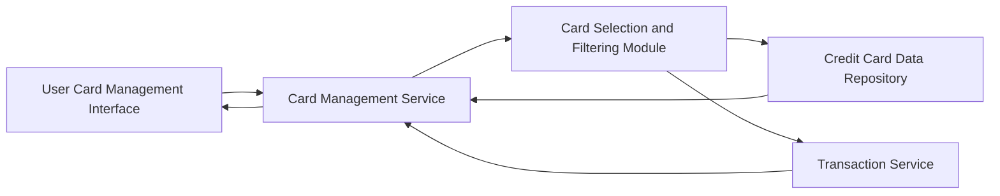

#### 1. High-Level Design

- **Summary**: This epic enables users to manage and monitor multiple credit cards from a unified interface, providing visibility into all cards, card-specific details (credit limits, balances, spending patterns), and card-wise spend analysis. The feature helps users optimize credit card usage across their portfolio by understanding which cards are utilized most and tracking individual card performance.

- **Component Flow**:

- **Integration Points**: 
  - **Upstream**: Credit Card Data Repository (for card information including limits, balances, card details), Transaction Service (for card-specific spending data and transaction history)
  - **Downstream**: User Card Management Interface (multiple card display, card details view, filtering controls)

- **Key Assumptions**: 
  - Card data is assumed to be pre-populated in the Credit Card Data Repository; users cannot add new cards via bank integration within this epic scope.
  - Card-wise spend analysis is calculated for the current month by default; historical analysis beyond current month is out of scope.

- **NFR Highlights**: System must support minimum 10 credit cards per user, card data retrieval must complete within 1 second, support concurrent viewing of multiple card details.

- **Data Flow**: User accesses the card management interface which displays all cards retrieved from the Credit Card Data Repository via the Card Management Service. User can apply filters or select specific cards through the Card Selection and Filtering Module. For each selected card, the Card Management Service retrieves card-specific details (credit limit, balance) from the Credit Card Data Repository and card-wise spending data from the Transaction Service. Aggregated card-level metrics are displayed in the user interface, enabling comparison and optimization of card usage across the portfolio.

#### 2. Validation Report

- **Requirements Coverage**: The design fully addresses the epic's scope including multiple credit card display, card-wise spend analysis, individual card details view, card selection and filtering, and card-specific credit limit and balance tracking. All NFRs (support for minimum 10 cards, 1-second retrieval time, concurrent viewing) are addressed through efficient data retrieval and filtering architecture. Integration dependencies with credit card data repository and transaction service are explicitly mapped. The design supports the stated user value of simplifying credit card portfolio management and optimizing card usage strategy.