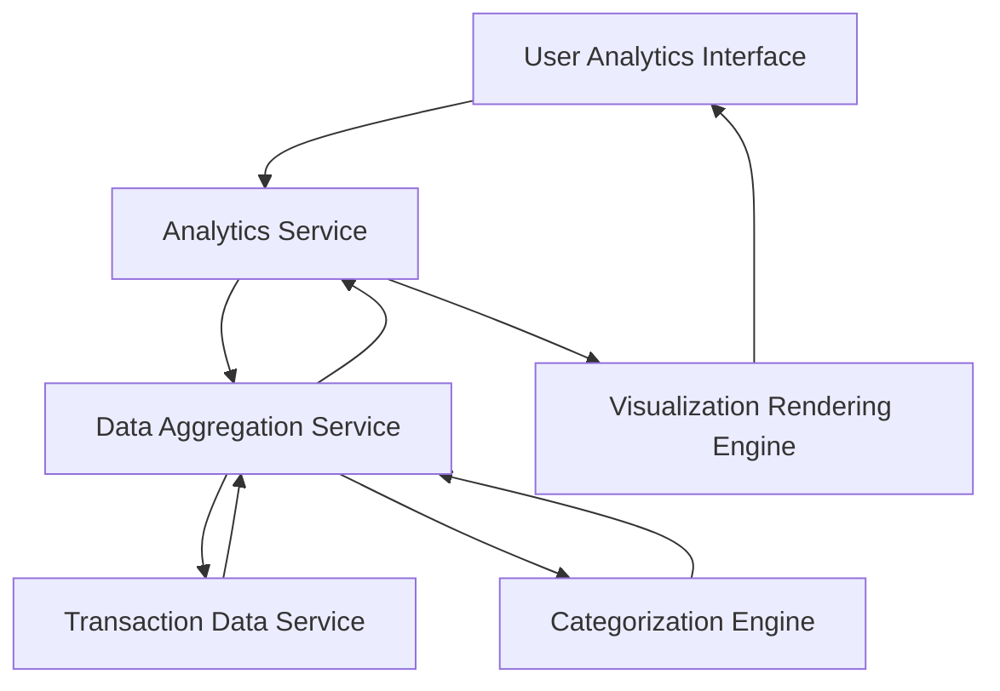

#### 1. High-Level Design

- **Summary**: This epic provides comprehensive spending analytics through interactive visualizations that enable users to understand spending behavior across nine predefined categories (Food and Dining, Fuel, Shopping, Travel, Entertainment, Utilities, Healthcare, Education, Miscellaneous). It includes monthly spend trend analysis and category-wise spending breakdowns to support better budgeting and financial decision-making.

- **Component Flow**:

- **Integration Points**: 
  - **Upstream**: Transaction Data Service (for raw transaction details), Categorization Engine (for mapping transactions to spending categories), Data Aggregation Service (for trend calculations and category summaries)
  - **Downstream**: User Analytics Interface (interactive charts, graphs, and drill-down capabilities)

- **Key Assumptions**: 
  - Transactions are pre-categorized or categorized in near real-time by the Categorization Engine using rule-based or ML-based classification; manual recategorization is not in scope.
  - Monthly trends are calculated for a rolling 12-month period unless otherwise specified; data aggregation occurs daily or on-demand.

- **NFR Highlights**: Analytics visualizations must render within 3 seconds, support interactive filtering and drill-down capabilities, handle minimum 1000 transactions per analysis period.

- **Data Flow**: User accesses the analytics interface and selects filters (date range, category, card). The Analytics Service requests aggregated data from the Data Aggregation Service, which retrieves raw transactions from the Transaction Data Service and applies categorization via the Categorization Engine. Aggregated category-wise spending and monthly trends are calculated and passed to the Visualization Rendering Engine, which generates interactive charts and graphs displayed in the user interface. User interactions (filtering, drill-down) trigger incremental data requests.

#### 2. Validation Report

- **Requirements Coverage**: The design comprehensively covers the epic's scope including category-wise spending visualization across nine predefined categories, monthly spend trends, interactive charts and graphs, and transaction categorization display. All NFRs (3-second rendering, interactive filtering, handling 1000+ transactions) are addressed through dedicated aggregation and visualization layers. Integration dependencies with transaction data service, categorization engine, and data aggregation service are explicitly mapped. The architecture supports the stated user value of empowering users with actionable insights for better budgeting decisions.