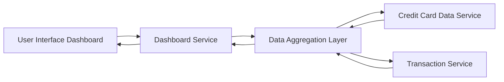

#### 1. High-Level Design

- **Summary**: This epic delivers a consolidated dashboard interface that displays critical financial KPIs including monthly spending, total credit limit across all cards, available credit, and outstanding amounts. The dashboard provides real-time visibility into credit card usage and credit health, enabling users to make informed financial decisions at a glance.

- **Component Flow**:

- **Integration Points**: 
  - **Upstream**: Credit Card Data Service (for retrieving card balances and credit limits), Transaction Service (for calculating monthly spend and outstanding amounts)
  - **Downstream**: User Interface Dashboard (web/mobile responsive views)

- **Key Assumptions**: 
  - Monthly spend is calculated based on the current calendar month; data refresh occurs at configurable intervals (assumed real-time or near real-time polling).
  - Credit limit aggregation assumes all active cards are included; inactive or closed cards are excluded from calculations.

- **NFR Highlights**: Dashboard must load within 2 seconds, support responsive design for mobile and desktop viewports, handle real-time data refresh for KPI updates.

- **Data Flow**: User accesses the dashboard UI which triggers a request to the Dashboard Service. The Dashboard Service queries the Data Aggregation Layer, which retrieves card balances and limits from the Credit Card Data Service and transaction data from the Transaction Service. Aggregated KPIs (monthly spend, total credit limit, available credit, outstanding amounts) are calculated and returned to the Dashboard Service, which renders the KPIs in responsive widgets on the user interface.

#### 2. Validation Report

- **Requirements Coverage**: The design fully covers the epic's stated scope including monthly spend display, total credit limit aggregation, available credit calculation, outstanding amount tracking, and responsive dashboard layout. All NFRs (2-second load time, responsive design, real-time refresh) are addressed through the architecture with dedicated aggregation and service layers. Integration dependencies with credit card data service and transaction service are explicitly mapped in the component flow.