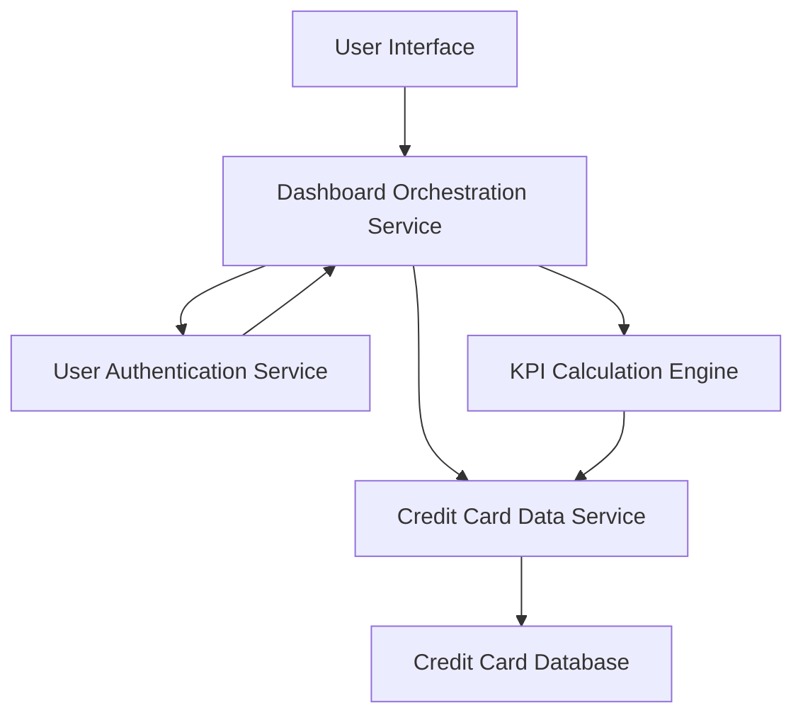

#### 1. High-Level Design

- **Summary:** This epic provides a consolidated dashboard displaying key performance indicators for all user credit cards including monthly spend, total credit limit, available credit, and outstanding amount. The system aggregates data from multiple credit cards into a single interface, providing users with comprehensive visibility into their credit card portfolio and financial health.

- **Component Flow:**

- **Integration Points:** 
  - **Upstream:** Credit Card Data Service (for retrieving card details and balances), User Authentication Service (for secure access to personal financial data), KPI Calculation Engine (for computing aggregated metrics)
  - **Downstream:** Credit Card Database (source of card data, balances, and transaction summaries)

- **Key Assumptions:** 
  - Credit card balance and limit data is updated in near real-time (within minutes) to support the 2-second dashboard load requirement
  - Available credit is calculated as (Total Credit Limit - Outstanding Amount) for each card and aggregated across all user cards

- **NFR Highlights:** System must be responsive across all device types and screen sizes; Dashboard must load within 2 seconds; Support real-time data refresh for accurate financial information

- **Data Flow:** User logs in and navigates to dashboard → User Authentication Service validates session → Dashboard Orchestration Service requests user's credit card data → Credit Card Data Service retrieves all cards associated with user → KPI Calculation Engine computes aggregated metrics (total monthly spend across all cards, sum of credit limits, total available credit, total outstanding amount) → Dashboard displays consolidated KPIs with individual card breakdowns → Real-time refresh mechanism polls for updated balances every 30-60 seconds → User views comprehensive credit card portfolio status within 2-second load time

#### 2. Validation Report

- **Requirements Coverage:** The design fully addresses all scope requirements including Dashboard KPIs display, monthly spend tracking, total credit limit aggregation, available credit calculation, outstanding amount display, multiple credit cards view, and consolidated interface. The architecture meets all NFRs through responsive UI design, optimized data retrieval for 2-second load time via Dashboard Orchestration Service, and real-time data refresh capability through periodic polling mechanism. The KPI Calculation Engine ensures accurate financial metrics aggregation across multiple cards, providing users with immediate visibility into their overall credit card financial status.