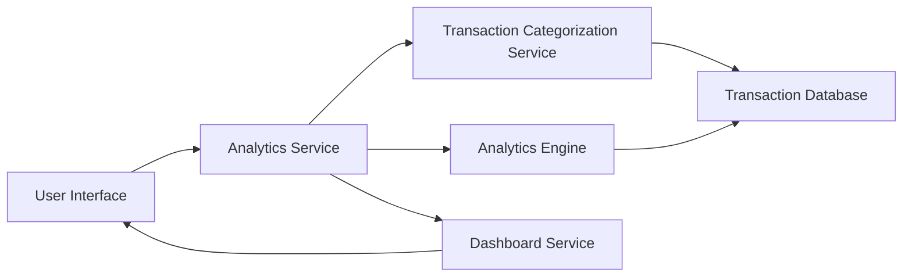

#### 1. High-Level Design

- **Summary:** This epic delivers interactive visualizations and analytics capabilities enabling users to understand spending patterns through category-wise analysis and monthly trends. The system processes transaction data, categorizes spending across 9 predefined categories (Food & Dining, Fuel, Shopping, Travel, Entertainment, Utilities, Healthcare, Education, Miscellaneous), and generates visual insights including card-wise spending breakdowns.

- **Component Flow:**

- **Integration Points:** 
  - **Upstream:** Transaction Categorization Service (for classifying spending by category), Analytics Engine (for processing spending data and generating insights), Dashboard Service (for rendering visualizations)
  - **Downstream:** Transaction Database (source of transaction data for analysis)

- **Key Assumptions:** 
  - Transactions are automatically categorized into one of the 9 predefined categories by the Transaction Categorization Service
  - Historical transaction data is available for at least 12 months to support meaningful monthly trend analysis

- **NFR Highlights:** Analytics visualizations must render within 3 seconds; System must support interactive filtering and drill-down capabilities; Charts must be responsive and accessible across all devices

- **Data Flow:** User accesses analytics dashboard → Analytics Service retrieves transaction data → Transaction Categorization Service classifies transactions into 9 categories → Analytics Engine aggregates spending by category, card, and time period → Dashboard Service generates interactive charts (category-wise pie/bar charts, monthly trend lines, card-wise breakdowns) → Visualizations rendered in UI within 3 seconds → User interacts with filters to drill down into specific categories, time periods, or cards

#### 2. Validation Report

- **Requirements Coverage:** The design comprehensively covers all scope elements including category-wise spending visualization, monthly spend trends analysis, card-wise spend analysis, interactive charts, and spending pattern identification across all 9 specified categories. The architecture supports the NFR requirements for 3-second rendering through dedicated Analytics Engine optimization, interactive filtering via Dashboard Service capabilities, and responsive design across devices. The component separation ensures scalability and maintainability for future analytics enhancements.