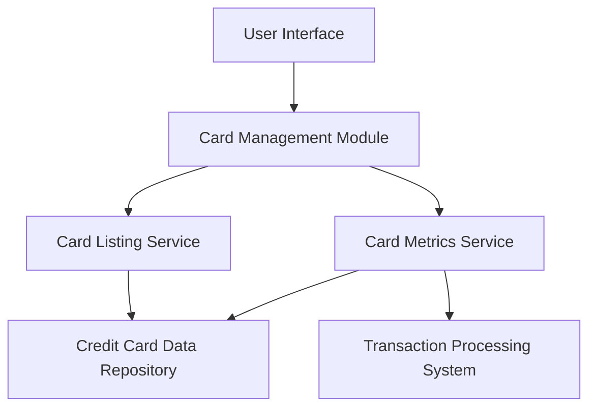

#### 1. High-Level Design

- **Summary:** This epic enables users to manage and view multiple credit cards within the dashboard. Users can access individual card details, track card-specific metrics, perform card-wise spend analysis, and compare usage patterns across their credit card portfolio. The feature supports comprehensive oversight of each card's status, credit limits, and spending behavior.

- **Component Flow:**

- **Integration Points:** 
  - Credit card data repository for storing and retrieving multiple card information
  - Transaction processing system for card-wise spend data

- **Key Assumptions:** 
  - Each card has a unique identifier enabling card-specific data isolation and retrieval.
  - Monthly spend trends are calculated based on transaction timestamps with month boundaries defined by calendar months.

- **NFR Highlights:** System must support management of at least 10 credit cards per user; Card data retrieval latency must be under 500ms; Ensure data isolation and security for multi-card views.

#### 2. Validation Report

- **Requirements Coverage:** The design addresses all scope elements including multiple credit card display, card-wise spend analysis, individual card detail views, card listing interface, card-specific metrics tracking, and monthly spend trends per card. The architecture incorporates both required integrations (credit card data repository and transaction processing system) and meets all NFRs related to capacity (10 cards), performance (500ms latency), and security (data isolation).