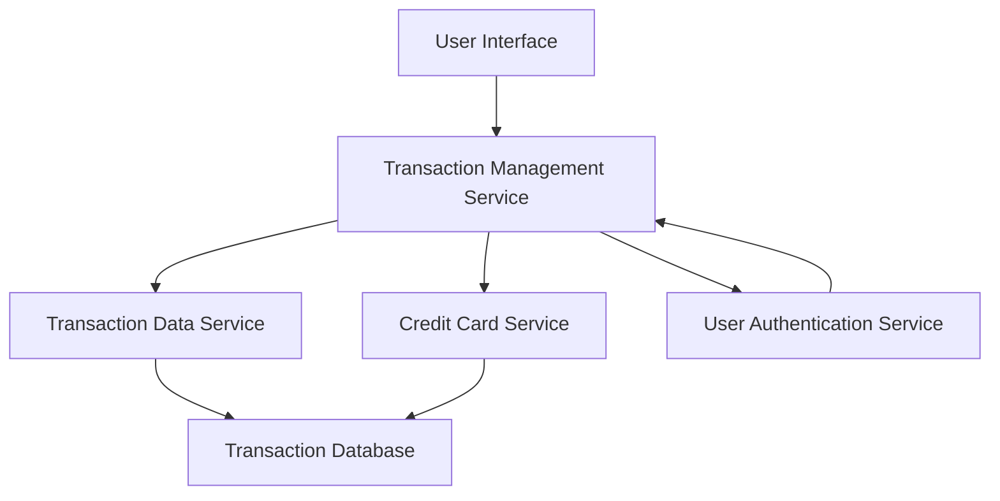

#### 1. High-Level Design

- **Summary:** This epic enables users to view and monitor all credit card transactions across multiple cards through a unified interface. The system retrieves transaction records, aggregates data from multiple cards, and displays detailed transaction history with proper security controls, enabling users to track spending and verify charges.

- **Component Flow:**

- **Integration Points:** 
  - **Upstream:** User Authentication Service (for secure access control), Credit Card Service (for card-specific filtering), Transaction Data Service (for retrieving transaction records)
  - **Downstream:** Transaction Database (data persistence layer)

- **Key Assumptions:** 
  - Transaction data is pre-categorized and stored in a structured format accessible via the Transaction Data Service
  - User authentication tokens are validated before each transaction query to ensure data security

- **NFR Highlights:** System must handle high volume of transaction records efficiently; Transaction data must be displayed with proper security measures; Interface must be responsive for mobile and desktop viewing

- **Data Flow:** User authenticates → User requests transaction history via UI → Transaction Management Service validates user session → Service queries Transaction Data Service and Credit Card Service → Transaction records are filtered by card and user ownership → Aggregated transaction list is returned to UI → User views detailed transaction history with ability to filter by card

#### 2. Validation Report

- **Requirements Coverage:** The design fully covers the epic's stated scope including transaction listing, transaction history view, multi-card transaction aggregation, and transaction details display. All NFRs regarding high-volume handling, security measures, and responsive interface are addressed through the layered architecture with dedicated authentication and data services. The component flow ensures secure data access and efficient retrieval of transaction records across multiple credit cards.