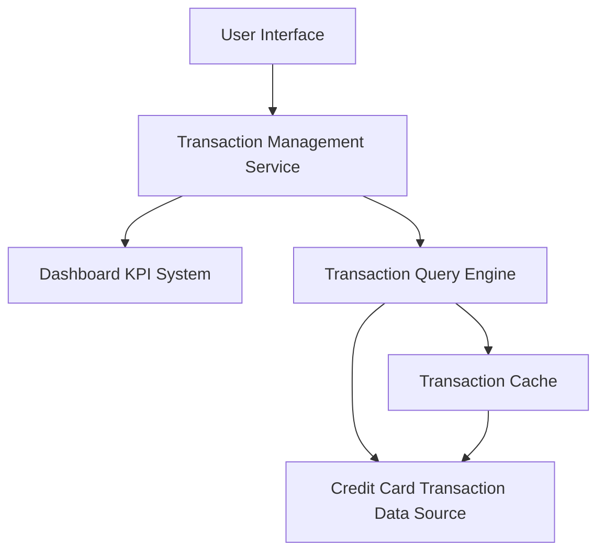

#### 1. High-Level Design

- **Summary:** This epic provides users with comprehensive transaction viewing capabilities across all their credit cards. Users can browse transaction history, view detailed transaction information, and access aggregated transaction data that feeds into the dashboard KPIs and spending analytics. The module ensures complete transparency of credit card usage by consolidating multi-card transaction data in a single interface.

- **Component Flow:**

- **Integration Points:**
  - **Upstream:** Credit card transaction data source (provides raw transaction records for all user credit cards)
  - **Downstream:** Dashboard KPI system (consumes transaction data for spend calculations and aggregations)
  - **Downstream:** Spending Analytics module (consumes transaction data for category-wise and trend analysis)

- **Key Assumptions:**
  - Transaction history is retained for 12 months in the primary data source; older transactions may be archived or unavailable for viewing.
  - Transaction details include standard fields such as date, merchant, amount, category, and card identifier; additional metadata availability depends on the upstream data source.

- **NFR Highlights:** System must handle transaction history for up to 12 months; Transaction retrieval API latency must be under 500ms; Support concurrent access for multiple users.

- **Data Flow:** User navigates to transaction view → Transaction Management Service authenticates request → Transaction Query Engine retrieves transaction list from Transaction Cache (if available) or Credit Card Transaction Data Source → Transactions are filtered by user's cards and time range (up to 12 months) → Transaction list is returned to User Interface and displayed → User selects a transaction to view details → Detailed transaction information is fetched and displayed → Transaction data is also made available to Dashboard KPI System for spend calculations and aggregations used in dashboard and analytics modules.

#### 2. Validation Report

- **Requirements Coverage:** The design fully addresses all requirements specified in the epic including transaction listing, transaction detail view, multi-card transaction aggregation, transaction history access, and transaction data display. The architecture integrates with both required dependencies (Credit card transaction data source and Dashboard KPI system for spend calculations). All NFRs are met: 12-month transaction history support via data retention policies, sub-500ms API latency through caching and optimized query engine, and concurrent user access via scalable service architecture. The design appropriately excludes out-of-scope items (real bank integration, transaction editing/deletion, payment processing, dispute management) as defined in the epic. The module serves as a foundational data provider for both dashboard KPIs and spending analytics.