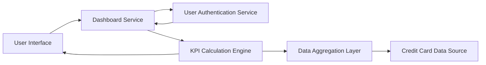

#### 1. High-Level Design

- **Summary:** This epic delivers a consolidated dashboard that displays key performance indicators for the user's credit card portfolio, including monthly spend, total credit limit, available credit, and outstanding amounts. Users can monitor multiple credit cards from a single responsive interface with real-time visibility into their financial position across all cards through KPI widgets.

- **Component Flow:**

- **Integration Points:**
  - **Upstream:** Credit card data source system (provides credit card account details, balances, limits, and transaction data)
  - **Upstream:** User authentication service (validates user identity and authorizes access to credit card data)
  - **Downstream:** Feeds aggregated spend data to the Spending Analytics module

- **Key Assumptions:**
  - Monthly spend is calculated as the sum of all transactions within the current calendar month; the calculation resets on the first day of each month.
  - Real-time data refresh refers to on-demand refresh triggered by user action or periodic polling (e.g., every 30-60 seconds), not streaming updates.

- **NFR Highlights:** Dashboard must be responsive across desktop, tablet, and mobile devices; Page load time must be under 2 seconds; Support for real-time data refresh.

- **Data Flow:** User logs in and is authenticated via User Authentication Service → Dashboard Service requests credit card data for the authenticated user → Data Aggregation Layer retrieves account details, balances, limits, and recent transactions from Credit Card Data Source → KPI Calculation Engine computes monthly spend, total credit limit, available credit, and outstanding amounts → Calculated KPIs are formatted and sent to User Interface → Dashboard displays KPI widgets showing consolidated financial position across all cards → User can trigger refresh to update KPIs with latest data.

#### 2. Validation Report

- **Requirements Coverage:** The design comprehensively addresses all stated requirements including monthly spend display, total credit limit calculation, available credit tracking, outstanding amount monitoring, multiple credit card view, responsive dashboard layout, and KPI widgets. The architecture integrates with both required dependencies (Credit card data source system and User authentication service). All NFRs are satisfied: responsive design across devices via adaptive UI components, sub-2-second page load through optimized data retrieval and caching strategies, and real-time data refresh capability via the dashboard service. The design explicitly excludes out-of-scope items (real bank integration, card payments, fund transfers, loans, payment gateway integration) as specified in the epic.