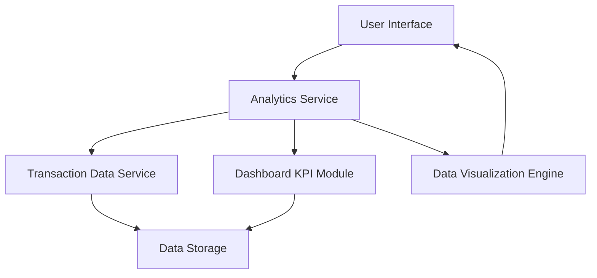

#### 1. High-Level Design

- **Summary:** This epic delivers an interactive analytics module that enables users to visualize and understand their credit card spending patterns through category-wise breakdowns (9 predefined categories: Food & Dining, Fuel, Shopping, Travel, Entertainment, Utilities, Healthcare, Education, Miscellaneous) and monthly spend trends. The module provides card-wise spend analysis with responsive, interactive charts to help users identify spending behaviors and make informed financial decisions.

- **Component Flow:**

- **Integration Points:**
  - **Upstream:** Transaction data service (provides raw transaction data for analysis)
  - **Upstream:** Dashboard KPI module (provides aggregated spend data)
  - **External:** Data visualization library (renders interactive charts and graphs)
  - **Internal:** Data storage layer for historical transaction and category data

- **Key Assumptions:**
  - Transaction categorization is performed upstream by the transaction data service or is pre-categorized in the data source; the analytics module consumes already-categorized transactions.
  - Monthly spend trends will cover a rolling 12-month period by default, with data aggregated on a monthly basis.

- **NFR Highlights:** Analytics visualizations must render within 3 seconds; Support for at least 9 spending categories; Charts must be interactive and responsive across desktop, tablet, and mobile devices.

- **Data Flow:** User requests spending analytics → Analytics Service retrieves categorized transaction data from Transaction Data Service and aggregated spend metrics from Dashboard KPI Module → Data is processed and grouped by category, card, and time period → Processed data is sent to Data Visualization Engine → Interactive charts and graphs are rendered and displayed to the user → User interacts with visualizations to drill down into specific categories, cards, or time periods.

#### 2. Validation Report

- **Requirements Coverage:** The design fully covers the epic's stated scope including category-wise spending visualization (9 categories), monthly spend trend analysis, card-wise spend analysis, and interactive charts. The architecture supports responsive rendering across all device types and integrates with the required dependencies (Transaction data service, Dashboard KPI module, Data visualization library). All NFRs are addressed through the component design: 3-second render time via optimized data retrieval and caching, 9+ category support via flexible data model, and responsive interactive charts via the visualization engine. The design explicitly excludes out-of-scope items (predictive analytics, budget alerts, AI insights, export functionality) as specified.