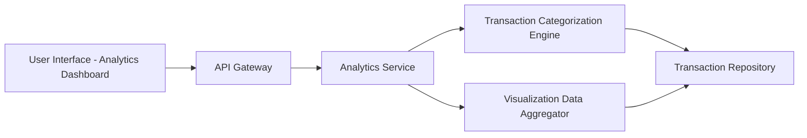

#### 1. High-Level Design

- **Summary:** This epic delivers interactive visualizations and analytics capabilities enabling users to understand spending patterns through monthly trends, card-wise analysis, and category-wise breakdowns across nine predefined categories (Food & Dining, Fuel, Shopping, Travel, Entertainment, Utilities, Healthcare, Education, Miscellaneous). The solution provides actionable insights into financial behavior through responsive, interactive charts.

- **Component Flow:**

- **Integration Points:** 
  - Transaction categorization engine or pre-categorized transaction data for category assignment
  - Analytics and visualization library or service (e.g., Chart.js, D3.js) for rendering interactive charts
  - Transaction data repository for historical spending data

- **Key Assumptions:** 
  - Transactions are pre-categorized or categorization rules are predefined and automated
  - Analytics aggregations are computed on-demand or pre-computed for common time ranges (monthly, quarterly)

- **NFR Highlights:** Visualizations must render within 3 seconds; System must support interactive filtering and drill-down capabilities; Charts must be responsive and mobile-friendly

- **Data Flow:** User accesses analytics dashboard → API Gateway routes to Analytics Service → Service requests categorized transaction data from Transaction Categorization Engine → Visualization Data Aggregator computes monthly trends, card-wise totals, and category-wise breakdowns from Transaction Repository → Aggregated data is formatted for visualization → UI renders interactive charts (line charts for trends, bar/pie charts for category breakdown) → User interacts with filters (date range, card selection, category drill-down) → Service re-aggregates and returns updated visualization data.

#### 2. Validation Report

- **Requirements Coverage:** The design fully addresses the epic's scope including monthly spend trends visualization, card-wise spend analysis, category-wise spending breakdown across all nine predefined categories, interactive charts and graphs, spending pattern identification, and multi-category analytics support. The architecture ensures NFR compliance with dedicated Visualization Data Aggregator for performance (3-second render time), responsive chart library selection, and interactive filtering capabilities. The design properly excludes out-of-scope features such as real bank integration, payments, custom category creation, budget setting/alerts, and predictive forecasts.