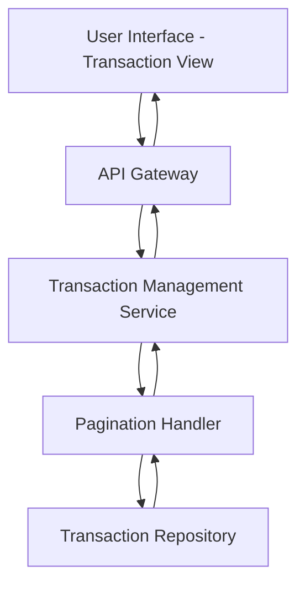

#### 1. High-Level Design

- **Summary:** This epic enables users to view and monitor credit card transactions across all their cards, providing access to detailed transaction history with accurate timestamps and amounts. The solution supports multi-card transaction viewing and efficient handling of large transaction datasets through pagination.

- **Component Flow:**

- **Integration Points:** 
  - Transaction data service or repository for retrieving historical and current transaction records
  - Credit card identification service to associate transactions with specific cards

- **Key Assumptions:** 
  - Transactions are stored in a queryable database with indexed fields for efficient retrieval
  - Pagination defaults to 20-50 transactions per page unless user-specified

- **NFR Highlights:** System must handle transaction lists efficiently with pagination for large datasets; Transaction data must be displayed with accurate timestamps and amounts

- **Data Flow:** User selects transaction view (all cards or specific card) → API Gateway routes request to Transaction Management Service → Service queries Transaction Repository with filters (card ID, date range) → Pagination Handler retrieves paginated results → Transaction details (timestamp, amount, merchant, status) are returned → UI displays transaction list with navigation controls for pagination.

#### 2. Validation Report

- **Requirements Coverage:** The design comprehensively addresses the epic's scope including transaction viewing, transaction history display, multi-card transaction support, and transaction details access. The architecture incorporates pagination handling to meet the NFR for efficient large dataset management. Accurate timestamps and amounts are ensured through direct retrieval from the Transaction Repository. The design respects out-of-scope boundaries by excluding real bank integration, payments, fund transfers, transaction disputes, and transaction categorization editing.