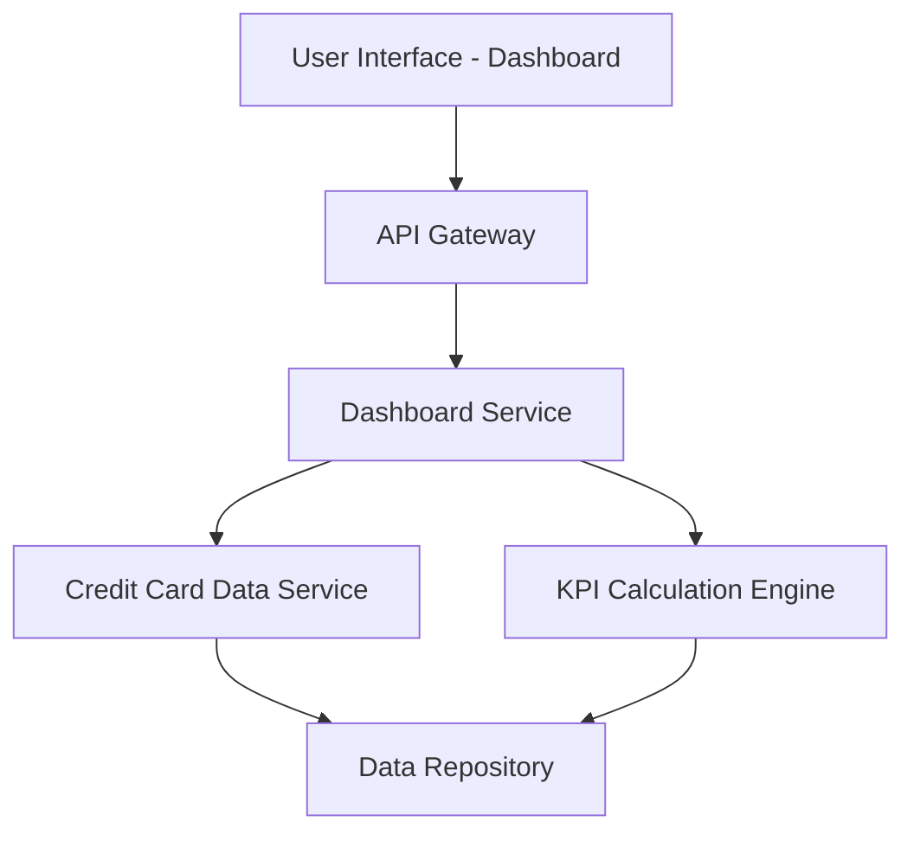

#### 1. High-Level Design

- **Summary:** This epic delivers a consolidated dashboard that aggregates and displays key performance indicators (KPIs) for all user credit cards, including monthly spend, total credit limit, available credit, and outstanding amounts. The solution provides a single-pane-of-glass view for users to monitor their credit card portfolio and overall financial health.

- **Component Flow:**

- **Integration Points:** 
  - Credit card data source or mock data service for card information
  - Transaction data service for spend calculations
  - Balance information service for outstanding amounts and credit limits

- **Key Assumptions:** 
  - Credit card data is available via REST API with standardized data format (JSON)
  - KPI calculations are performed server-side and cached for performance

- **NFR Highlights:** Dashboard must load within 2 seconds; System must provide responsive layouts across devices; Support real-time data refresh for KPIs

- **Data Flow:** User requests dashboard → API Gateway routes to Dashboard Service → Dashboard Service fetches credit card details from Credit Card Data Service → KPI Calculation Engine aggregates monthly spend, total credit limit, available credit, and outstanding amounts from Data Repository → Calculated KPIs and card information are returned to UI → Dashboard displays consolidated view with all cards and KPIs.

#### 2. Validation Report

- **Requirements Coverage:** The design fully covers the epic's stated scope including Dashboard KPIs display, monthly spend tracking, total credit limit aggregation, available credit calculation, outstanding amount display, multiple credit card view, and consolidated interface. All NFRs (2-second load time, responsive layout, real-time refresh) are addressed through the architecture with API Gateway for routing, dedicated services for data retrieval and calculation, and caching mechanisms. The design explicitly excludes out-of-scope items (real bank integration, payments, fund transfers, loans, payment gateway).