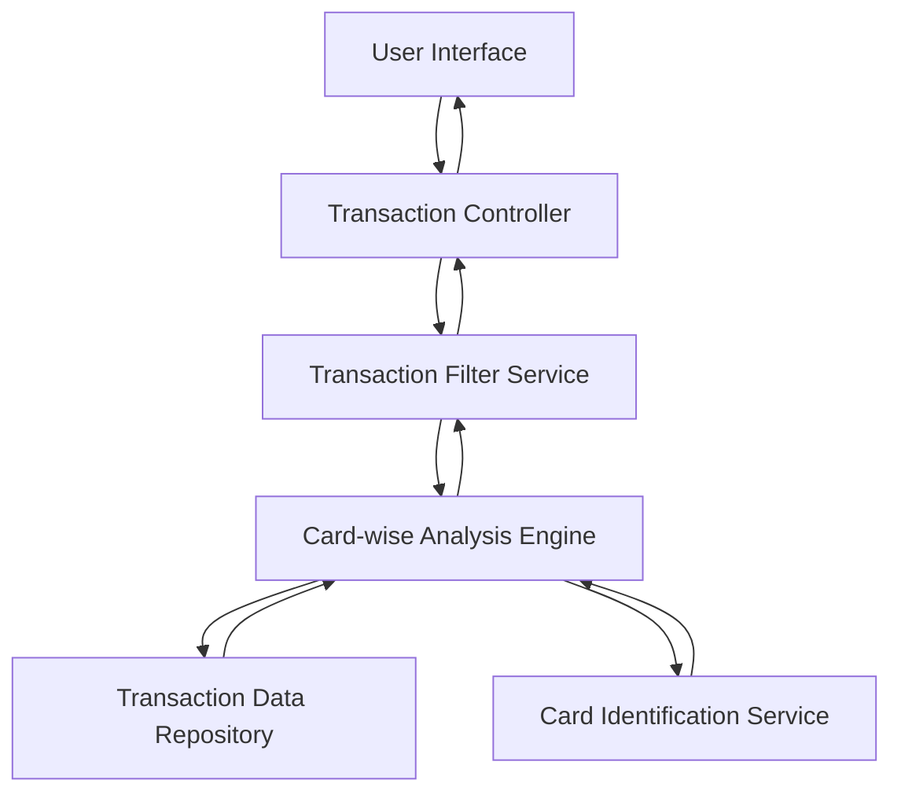

### 1. High-Level Design

**Summary:**  
This epic enables users to view, filter, and analyze transactions across all credit cards with detailed card-wise spending breakdowns. Users can access transaction histories, filter by specific cards, and understand spending patterns at the individual card level to support financial planning and card optimization strategies.

**Component Flow:**

**Integration Points:**
- Transaction data service or repository for retrieving transaction records
- Card identification service for mapping transactions to specific credit cards
- Data refresh mechanism for near real-time or scheduled updates

**Key Assumptions:**
- Transactions are pre-mapped to card IDs in the data repository; filtering is performed via indexed queries.
- Transaction data refresh occurs at defined intervals (e.g., hourly) with a timestamp indicating last update.

**NFR Highlights:**  
Transaction queries must return results within 1 second; system must handle minimum 1000 transactions per card; data refresh rate should be near real-time or clearly indicated.

### 2. Validation Report

**Requirements Coverage:**  
The design comprehensively covers the epic's scope including transaction listing and display, card-wise spend analysis, transaction filtering by card, transaction history access, and multi-card transaction aggregation. The component architecture includes dedicated services for filtering and card-wise analysis, ensuring efficient query performance to meet the 1-second response time NFR. The integration with transaction data repository and card identification service aligns with stated dependencies. The design supports the requirement to handle 1000+ transactions per card through appropriate data access patterns.