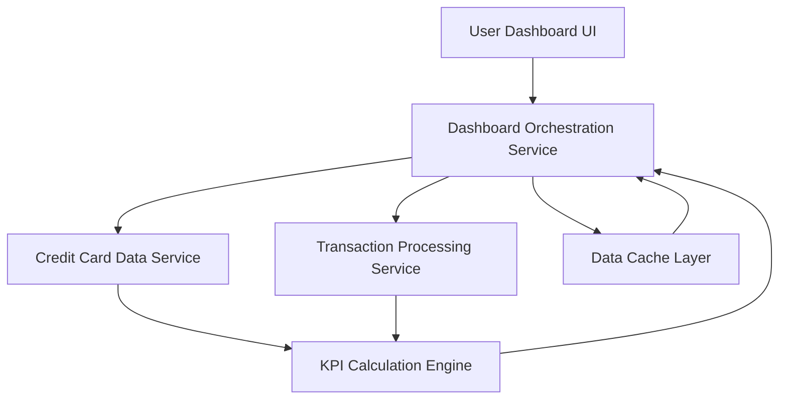

#### 1. High-Level Design

- **Summary:** This epic delivers a consolidated dashboard that displays critical KPIs for the user's entire credit card portfolio in a single, responsive interface. Key metrics include monthly spend, total credit limit, available credit, and outstanding amounts aggregated across all cards. The dashboard provides real-time visibility into overall credit card financial health with sub-2-second load times and supports desktop, tablet, and mobile devices.

- **Component Flow:**

- **Integration Points:**
  - **Upstream:** Credit card data service for retrieving card information, limits, and current balances
  - **Upstream:** Transaction processing service for calculating monthly spend and outstanding amounts
  - **Internal:** KPI calculation engine for real-time aggregation and metric computation

- **Key Assumptions:**
  - "Real-time" data refresh means near-real-time (within 5-10 seconds of transaction posting) rather than true real-time streaming.
  - KPI calculations (available credit, outstanding amounts) use standard formulas: Available Credit = Total Limit - Outstanding Amount.

- **NFR Highlights:** Dashboard must load within 2 seconds, provide responsive layouts across desktop/tablet/mobile, and support real-time data refresh for KPI metrics.

- **Data Flow:** User accesses dashboard → Dashboard Orchestration Service checks Data Cache Layer for recent KPIs → If cache miss or stale, service queries Credit Card Data Service for card limits/balances and Transaction Processing Service for spend/outstanding amounts → KPI Calculation Engine aggregates data across all cards (total limits, total available credit, total outstanding, monthly spend) → Computed KPIs are cached and returned to Dashboard UI → UI renders KPIs in responsive layout → Periodic refresh triggers re-query of services to update metrics.

#### 2. Validation Report

- **Requirements Coverage:** The design fully satisfies the epic's scope including consolidated KPI display (monthly spend, total credit limit, available credit, outstanding amounts), multi-card aggregation, and responsive layout. All NFRs are addressed: sub-2-second load time through caching layer, responsive design for desktop/tablet/mobile through adaptive UI framework, and real-time refresh capability via orchestration service polling. Integration dependencies with credit card data service and transaction processing service are properly defined and enable the required KPI calculations and data aggregation.