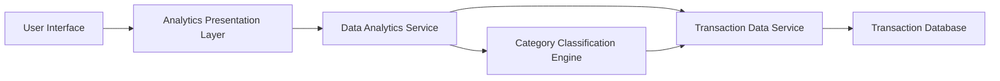

#### 1. High-Level Design

- **Summary:** This epic provides comprehensive spending analytics across 9 predefined categories (Food & Dining, Fuel, Shopping, Travel, Entertainment, Utilities, Healthcare, Education, Miscellaneous) with interactive visualizations. Users can analyze monthly spend trends, view category-wise breakdowns, access transaction history, and identify spending patterns over at least 12 months of historical data. The system delivers actionable insights for budget optimization and financial decision-making.

- **Component Flow:**

- **Integration Points:**
  - **Upstream:** Transaction data service for retrieving historical and real-time transaction records
  - **Internal:** Category classification engine for automated expense categorization and pattern recognition
  - **Internal:** Data analytics service for trend calculation, aggregation, and pattern analysis

- **Key Assumptions:**
  - Transactions are pre-categorized by the Classification Engine using rule-based or ML algorithms; manual re-categorization by users is not in scope.
  - Historical transaction data for 12 months is available and accessible with acceptable query performance.

- **NFR Highlights:** Visualizations must render within 3 seconds, support 12 months of historical data analysis, and provide responsive interactive charts with drill-down capabilities across devices.

- **Data Flow:** User requests analytics view → Analytics Presentation Layer queries Data Analytics Service → Service retrieves raw transactions from Transaction Data Service → Category Classification Engine tags transactions with categories → Analytics Service aggregates data by category and time period, calculates trends → Processed analytics data with visualizations (charts, graphs) are rendered in UI → User interactions (drill-down, filtering) trigger refined queries back to Analytics Service.

#### 2. Validation Report

- **Requirements Coverage:** The design comprehensively addresses all stated requirements including category-wise visualization (9 categories), monthly trend analysis, interactive charts, transaction history, and spending pattern identification. All NFRs are met: 3-second rendering through optimized analytics service, 12-month historical data support via transaction database, and responsive interactive charts through modern UI framework. Integration dependencies with transaction data service, classification engine, and analytics service are clearly defined and support the required functionality.