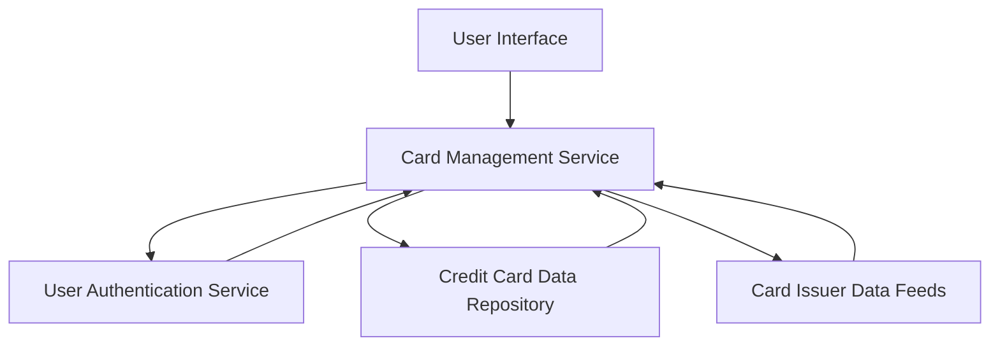

#### 1. High-Level Design

- **Summary:** This epic delivers a multi-card management capability that allows users to register, view, and manage up to 10 credit cards within a unified interface. Users can access individual card details, perform card-wise spend analysis, and compare usage patterns across cards. The system provides secure card information storage with masked card numbers and enables card-specific tracking of limits and balances.

- **Component Flow:**

- **Integration Points:**
  - **Upstream:** User authentication service for card ownership verification
  - **Upstream:** Card issuer data feeds for retrieving card details and metadata
  - **Internal:** Credit card data repository for persistent storage of card information

- **Key Assumptions:**
  - Card data from issuer feeds is provided in a standardized JSON/XML format with consistent schema across different card issuers.
  - Card registration requires manual user input of card details; no automated card discovery mechanism is assumed.

- **NFR Highlights:** System must support at least 10 cards per user, card data retrieval within 1 second, secure storage with PCI-DSS compliant card masking (display only last 4 digits).

- **Data Flow:** User initiates card registration through UI → Card Management Service validates user ownership via Authentication Service → Card details are stored in Card Data Repository with encryption → Service retrieves card metadata from Card Issuer Data Feeds → Masked card information is displayed to user → For card-wise analysis, service aggregates spend data from repository and presents comparative metrics back to UI.

#### 2. Validation Report

- **Requirements Coverage:** The design fully covers the epic's stated scope including multiple card display, card-wise analysis, individual card details view, comparison capabilities, and secure card information handling. All NFRs (10 cards per user, 1-second retrieval, masked display) are addressed through appropriate architectural components. The integration dependencies are satisfied through defined service interfaces with authentication, data repository, and card issuer feeds.