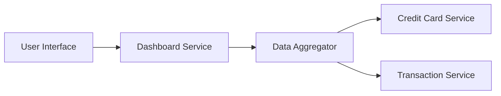

### 1. High-Level Design

**Summary:**  
This epic delivers a centralized dashboard that displays critical financial KPIs including monthly spending, total credit limit, available credit, and outstanding amounts across all credit cards. The dashboard provides users with a consolidated view of their credit card financial health to support informed spending decisions.

**Component Flow:**

**Integration Points:**
- **Upstream:** Credit Card data source (for card limits and balances), Transaction service (for monthly spend and outstanding amounts)
- **Downstream:** User Interface layer for rendering dashboard metrics

**Key Assumptions:**
- KPI data is aggregated in real-time or near real-time from source systems; data refresh frequency is assumed to be configurable.
- Credit utilization calculations follow standard formula: (Outstanding Amount / Total Credit Limit) × 100.

**NFR Highlights:**  
Dashboard must load within 2 seconds, support responsive design for mobile and desktop devices, handle real-time data refresh for KPI metrics.

### 2. Validation Report

**Requirements Coverage:**  
The design covers all stated requirements including monthly spend display, total credit limit calculation, available credit tracking, outstanding amount monitoring, and consolidated dashboard view with responsive layout. The component flow ensures integration with Credit Card and Transaction services as specified in dependencies.