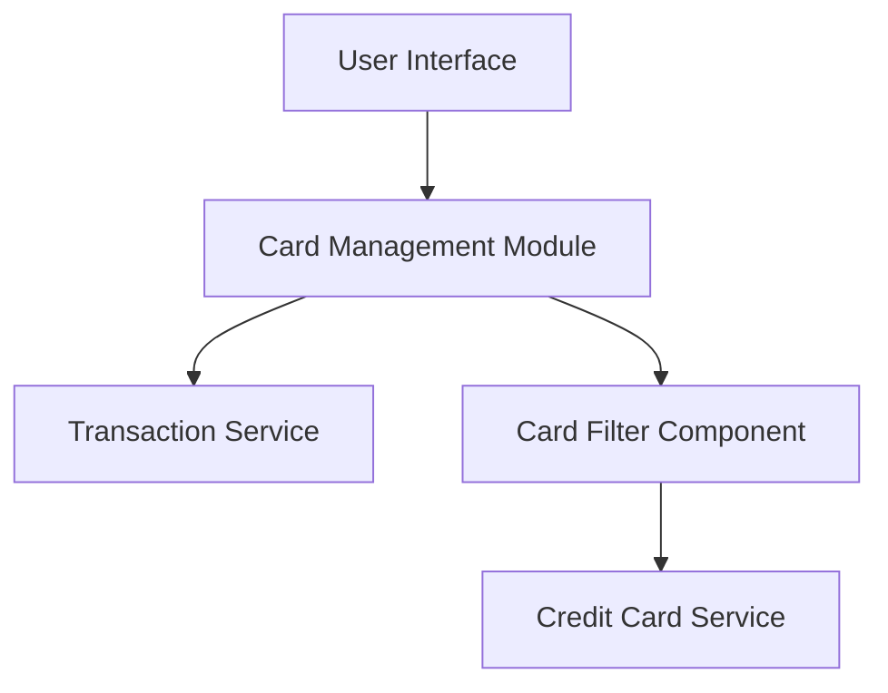

### 1. High-Level Design

**Summary:**  
This epic enables users to manage and view multiple credit cards within a single interface, providing individual card details, card-specific metrics, and card-wise spend analysis. The feature consolidates all credit cards in one view for easier portfolio management and comparison.

**Component Flow:**

**Integration Points:**
- **Upstream:** Credit Card service (for card information and metadata), Transaction service (for card-specific spending data)
- **Downstream:** User Interface for displaying card list, details, and filtering options

**Key Assumptions:**
- Card data structure includes standard fields: card number (masked), card type, issuer, limit, balance, status, expiry date.
- Card-wise spend analysis aggregates transactions by card identifier; transaction categorization is handled by Transaction service.

**NFR Highlights:**  
System must support display of at least 10 credit cards per user, card list must render within 1 second, maintain data consistency across card views.

### 2. Validation Report

**Requirements Coverage:**  
The design addresses all functional requirements including multiple credit card display, card-wise spend analysis, individual card details view, card status tracking, and card selection/filtering. Integration points with Credit Card and Transaction services are clearly defined to support the stated scope.