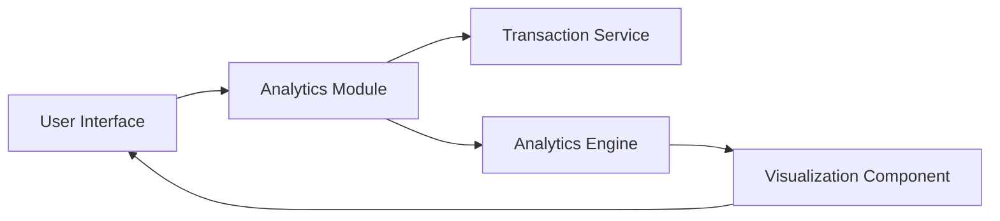

### 1. High-Level Design

**Summary:**  
This epic provides interactive visualizations and analytics for understanding spending patterns through category-wise breakdowns and monthly trends. Users can analyze spending across nine predefined categories (Food & Dining, Fuel, Shopping, Travel, Entertainment, Utilities, Healthcare, Education, Miscellaneous) to make data-driven financial decisions.

**Component Flow:**

**Integration Points:**
- **Upstream:** Transaction service (for categorized transaction data), Analytics engine (for trend calculations and aggregations)
- **Downstream:** Visualization Component for rendering charts and graphs in the User Interface

**Key Assumptions:**
- Transaction data is pre-categorized by the Transaction service; category assignment logic resides upstream.
- Monthly trend analysis uses calendar month boundaries; historical data retention is at least 12 months as per NFR.

**NFR Highlights:**  
Visualizations must render within 3 seconds, support interactive filtering and drill-down capabilities, handle up to 12 months of historical transaction data for trend analysis.

### 2. Validation Report

**Requirements Coverage:**  
The design fully covers the epic scope including category-wise spending visualization, monthly spend trends analysis, interactive charts and graphs, spending pattern identification, and breakdown across all nine specified categories. The architecture supports the stated NFRs for performance and interactivity with clear integration to Transaction service and Analytics engine.