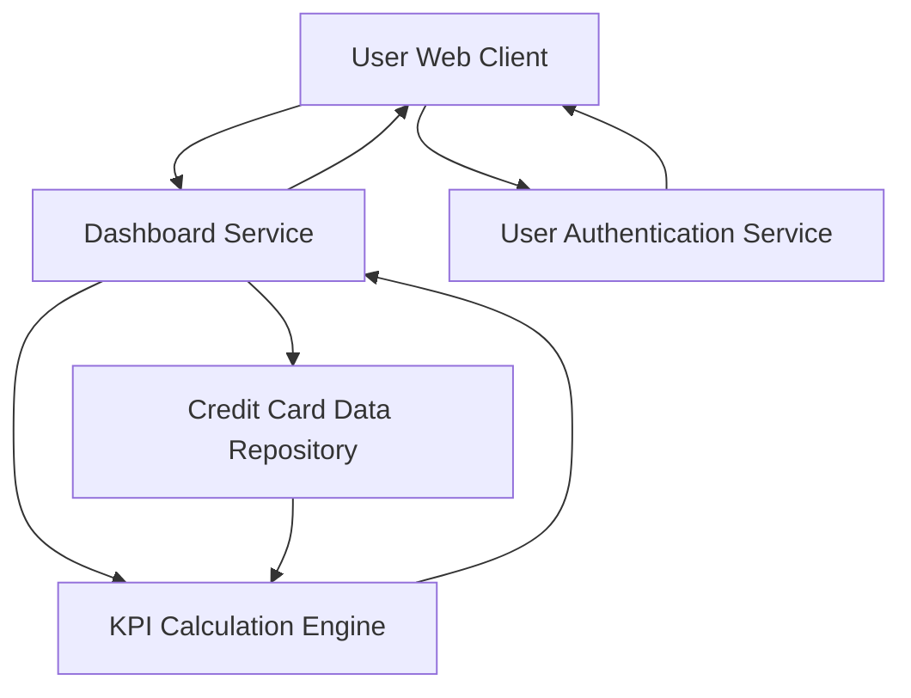

#### 1. High-Level Design

- **Summary:** This epic delivers the core dashboard functionality providing users with a consolidated view of their credit card portfolio and key performance indicators (KPIs). Users can view essential financial metrics—monthly spend, total credit limit, available credit, and outstanding amounts—across all credit cards from a single, modern, responsive interface serving as the primary entry point for credit card portfolio monitoring.

- **Component Flow:**

- **Integration Points:**
  - **Upstream:** Credit card data repository or database service for retrieving card details, balances, and transaction summaries
  - **Security:** User authentication service for secure access to personal financial information
  - **Potential:** Real-time or near real-time data refresh mechanism (specific integration not detailed in epic)

- **Key Assumptions:**
  - KPI calculations (monthly spend, available credit, outstanding amount) are computed server-side by KPI Calculation Engine based on current data snapshots
  - "Real-time or near real-time" data refresh implies periodic polling or event-driven updates; specific refresh interval not defined (assuming 30-60 second refresh cycle)

- **NFR Highlights:** Dashboard must be responsive across desktop, tablet, and mobile devices; page load time optimized for quick access; data refresh in real-time or near real-time to ensure accuracy of financial metrics

- **Data Flow:** User accesses dashboard URL → User Authentication Service validates credentials → Upon successful authentication, Dashboard Service is invoked → Service retrieves credit card details from Credit Card Data Repository → KPI Calculation Engine computes Monthly Spend, Total Credit Limit, Available Credit, and Outstanding Amount for each card and portfolio-wide → Consolidated KPI data and credit card list are returned to Dashboard Service → Dashboard Service formats response for User Web Client → Responsive dashboard UI renders KPIs and multiple credit card views → Data refresh occurs periodically (real-time/near real-time) to update financial metrics without full page reload

#### 2. Validation Report

- **Requirements Coverage:** The design fully satisfies the epic's scope including dashboard KPIs display (Monthly Spend, Total Credit Limit, Available Credit, Outstanding Amount), multiple credit card view, consolidated credit card portfolio interface, and responsive layout design. All NFRs are addressed: responsive design across devices through adaptive UI components, optimized page load time via efficient Dashboard Service and KPI Calculation Engine, and real-time/near real-time data refresh through periodic data synchronization. Dependencies on credit card data repository and user authentication service are explicitly integrated into the architecture.