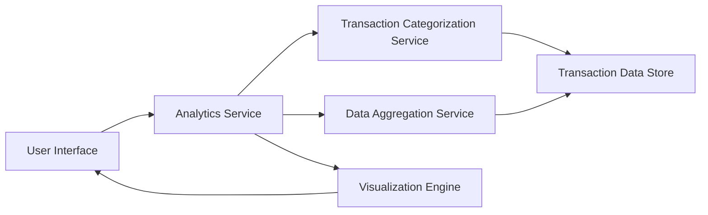

#### 1. High-Level Design

- **Summary:** This epic provides advanced analytics and visualization capabilities that transform transaction data into actionable financial insights. Users access interactive visualizations for category-wise spending across nine categories (Food & Dining, Fuel, Shopping, Travel, Entertainment, Utilities, Healthcare, Education, Miscellaneous), monthly spend trends, and card-wise spend analysis through a responsive analytics interface.

- **Component Flow:**

- **Integration Points:**
  - **Upstream:** Transaction categorization service/algorithm for classifying transactions into nine spending categories
  - **Upstream:** Data aggregation service for computing spending trends and analytics
  - **Technology:** Charting library or visualization framework for rendering interactive graphs (e.g., Chart.js, D3.js, or similar)

- **Key Assumptions:**
  - Transaction categorization is automated via ML/rule-based algorithm; manual recategorization is out of scope
  - Monthly trends are calculated based on transaction date; fiscal vs. calendar month logic not specified (assuming calendar month)

- **NFR Highlights:** Visualizations must render efficiently with large datasets; analytics calculations must be performant without impacting UX; charts/graphs must be responsive and interactive across all device types (desktop, tablet, mobile)

- **Data Flow:** User navigates to analytics section → Analytics Service requests categorized transaction data from Transaction Categorization Service → Categorization Service retrieves raw transactions from Transaction Data Store and applies categorization logic → Data Aggregation Service computes category-wise totals, monthly trends, and card-wise spending metrics → Aggregated data is passed to Visualization Engine → Interactive charts and graphs are rendered on User Interface → User interacts with visualizations (drill-down, filter by time period, switch between views) → UI updates dynamically based on user interactions

#### 2. Validation Report

- **Requirements Coverage:** The design comprehensively addresses all scope elements including category-wise spending visualization across nine categories, monthly spend trends analysis, card-wise spend analysis, interactive charts/graphs, and responsive analytics interface. All NFRs are covered through architectural decisions: efficient rendering via dedicated Visualization Engine, performant analytics calculations through optimized Data Aggregation Service, and responsive design across devices. Dependencies on transaction categorization, data aggregation, and charting libraries are explicitly integrated into the component architecture.