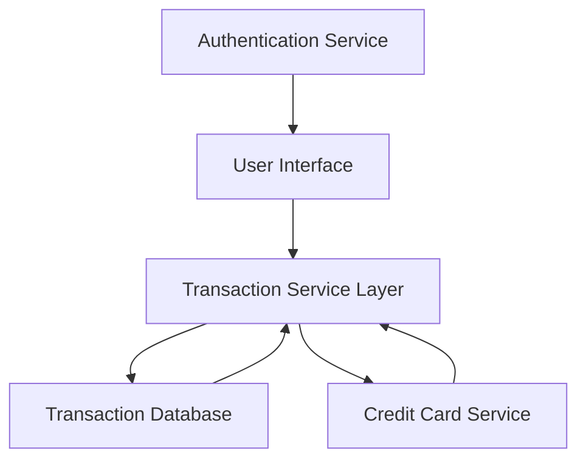

#### 1. High-Level Design

- **Summary:** This epic delivers comprehensive transaction monitoring capabilities across multiple credit cards, enabling users to view, track, search, and analyze individual transactions at a granular level. The system provides a responsive interface for transaction list display, detailed transaction information, multi-card aggregation, and filtering/search capabilities to support spending transparency and unauthorized charge detection.

- **Component Flow:**

- **Integration Points:** 
  - **Upstream:** Transaction data service/database for retrieving historical and current transaction records
  - **Lateral:** Credit card service for associating transactions with specific cards
  - **Security:** User authentication service (implied dependency for secure access)

- **Key Assumptions:** 
  - Transaction data is pre-categorized or raw and will be displayed as-is without real-time categorization in this epic
  - Transaction refresh frequency is determined by the upstream transaction data service capabilities

- **NFR Highlights:** System must handle large volumes of transaction data efficiently; pagination or infinite scroll required for performance; search/filter operations must return results within acceptable response times (specific SLA not defined in epic)

- **Data Flow:** User authenticates and accesses the transaction interface → Transaction Service Layer retrieves transaction records from Transaction Database → Service associates transactions with specific credit cards via Credit Card Service → Aggregated multi-card transaction data is returned to UI → User applies filters/search criteria → Filtered results are displayed with pagination support → User selects transaction for detailed view → Detailed transaction information is rendered on UI

#### 2. Validation Report

- **Requirements Coverage:** The design fully covers the epic's stated scope including transaction list view, transaction details display, multi-card transaction aggregation, search and filter capabilities, and responsive interface. All NFRs regarding efficient data handling, pagination/infinite scroll, and acceptable search response times are addressed through the layered architecture with dedicated Transaction Service Layer and database optimization strategies.