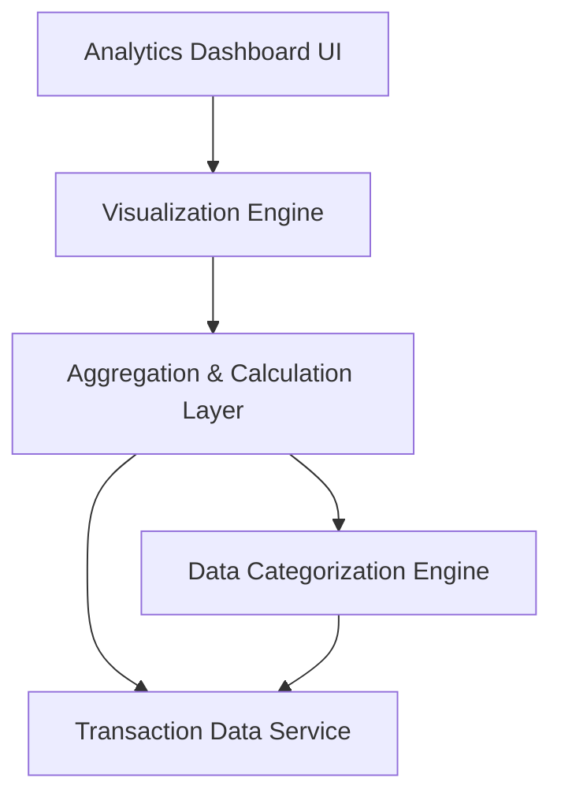

#### 1. High-Level Design

**Summary:** This epic provides interactive analytics and visualization capabilities that enable users to understand spending patterns through category-wise breakdowns and monthly trend analysis. Users can view spending across nine predefined categories (Food & Dining, Fuel, Shopping, Travel, Entertainment, Utilities, Healthcare, Education, Miscellaneous) and visualize monthly trends to identify patterns and make data-driven financial decisions.

**Component Flow:**

**Integration Points:**
- **Upstream:** Transaction data service for retrieving spending details
- **Upstream:** Data categorization engine for classifying transactions into appropriate categories
- **Internal:** Visualization library for rendering charts and graphs (e.g., Chart.js, D3.js, or similar)

**Key Assumptions:**
- Transactions are categorized either at ingestion time by the categorization engine or on-demand using rule-based or ML-based classification; historical data is pre-categorized for performance.
- Monthly trend analysis covers a default period (e.g., last 12 months) with user ability to adjust date ranges; data is aggregated at the day/month level.

**NFR Highlights:** Analytics visualizations must render efficiently even with large transaction datasets; charts and graphs must be interactive and responsive; category calculations must be accurate and update in near real-time.

#### 2. Validation Report

**Requirements Coverage:** The design comprehensively covers all scope elements including category-wise spending visualization, monthly spend trend charts, interactive analytics dashboard, spending pattern analysis across nine predefined categories, transaction categorization, and data visualization components. The architecture integrates with transaction data service and data categorization engine as specified in dependencies. All NFRs regarding efficient rendering with large datasets, interactivity, responsiveness, and near real-time accuracy are addressed in the component design.