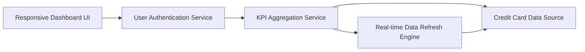

#### 1. High-Level Design

**Summary:** This epic delivers a centralized, responsive dashboard that consolidates key performance indicators (KPIs) for all user credit cards in a single view. Users can monitor monthly spending, total credit limit, available credit, and outstanding amounts across their entire credit card portfolio with real-time visibility to support informed financial decisions.

**Component Flow:**

**Integration Points:**
- **Upstream:** Credit card data source/database for retrieving card information and balances
- **Upstream:** User authentication service for secure access to personal financial data
- **Internal:** Real-time data refresh mechanism for KPI updates

**Key Assumptions:**
- KPI calculations (total credit limit, available credit, outstanding amounts) are computed on-the-fly by aggregating data from individual cards; refresh frequency is configurable (e.g., every 5 minutes or on-demand).
- Dashboard supports responsive breakpoints for desktop (>1024px), tablet (768-1024px), and mobile (<768px) devices.

**NFR Highlights:** Dashboard must be responsive across desktop, tablet, and mobile devices; page load time must be optimized for quick access to financial data; system must handle real-time data refresh for KPI metrics.

#### 2. Validation Report

**Requirements Coverage:** The design addresses all core requirements including dashboard interface development, KPI displays (monthly spend, total credit limit, available credit, outstanding amount), responsive layout implementation, and multi-card consolidated view. The architecture supports real-time data refresh and integration with credit card data sources and authentication services. All specified NFRs regarding responsiveness, performance optimization, and real-time refresh are incorporated into the design.