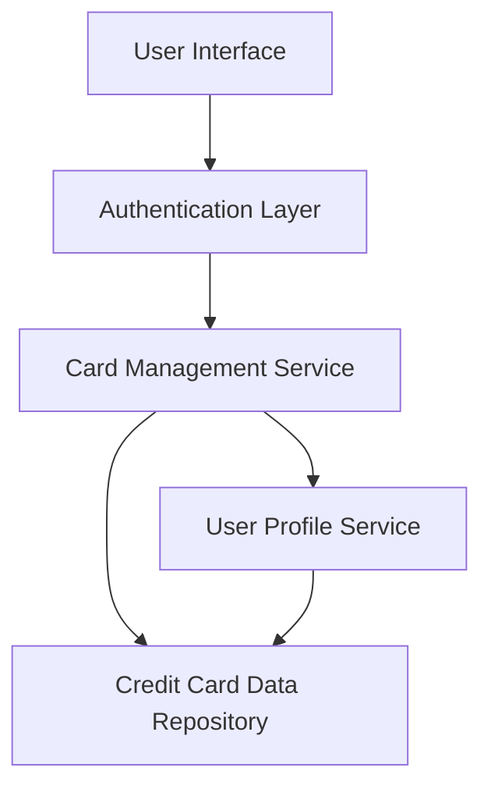

#### 1. High-Level Design

**Summary:** This epic provides a comprehensive credit card portfolio management interface where users can view, manage, and track multiple credit cards from a single dashboard. It enables users to access card-specific details, monitor individual card performance, track status, limits, and usage patterns for each card in their portfolio.

**Component Flow:**

**Integration Points:**
- **Upstream:** User profile service for associating cards with users
- **Downstream:** Credit card data repository for storing and retrieving card information
- **Cross-cutting:** Authentication service (implied for secure access)

**Key Assumptions:**
- Card data will be retrieved via REST API from the credit card data repository; updates will occur on-demand or via scheduled refresh.
- User profile service maintains a many-to-many relationship between users and cards with appropriate access control policies.

**NFR Highlights:** System must support multiple credit cards per user without performance degradation; card data must be securely stored and transmitted; interface must maintain usability with increasing number of cards.

#### 2. Validation Report

**Requirements Coverage:** The design covers all stated scope items including multiple credit card display, individual card details view, card-wise spend analysis, card status tracking, and card information management interface. The component architecture supports the integration dependencies with user profile service and credit card data repository. Security and performance NFRs are addressed through secure data transmission and scalable architecture patterns.