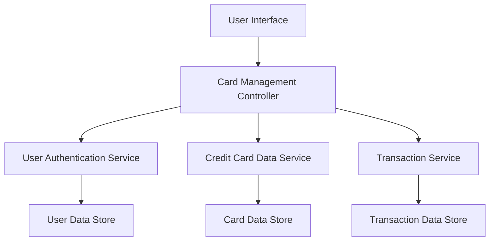

#### 1. High-Level Design

- **Summary:** This epic provides comprehensive functionality for users to manage and monitor multiple credit cards within a single interface. Users can view all their credit cards, access card-specific details, perform card-wise spend analysis, track individual card performance, compare spending across cards, and understand utilization patterns for each card separately, eliminating the need for multiple banking portals.

- **Component Flow:**

- **Integration Points:**
  - **Upstream:** Credit Card Data Service (retrieves card information), User Authentication Service (provides secure access control), Transaction Service (provides card-specific spending data)
  - **Downstream:** User Interface (displays card list, card details, and card-wise analysis)

- **Key Assumptions:**
  - Card information includes masked card numbers (last 4 digits visible) with full encryption at rest and in transit
  - Card comparison functionality supports side-by-side view of up to 3-4 cards simultaneously for effective analysis

- **NFR Highlights:** System must support management of at least 10 credit cards per user, card data retrieval must complete within 1 second, ensure secure display with appropriate masking of sensitive card details

- **Data Flow:** User logs in and is authenticated via the User Authentication Service. The Card Management Controller requests the user's card portfolio from the Credit Card Data Service, which retrieves card information from the Card Data Store. Cards are displayed with masked sensitive details. When a user selects a specific card, the controller requests card-specific spending data from the Transaction Service, which queries the Transaction Data Store. The UI displays individual card details including balance, credit limit, utilization percentage, and card-wise spending analysis. Users can filter, compare, and drill down into individual card performance metrics.

#### 2. Validation Report

- **Requirements Coverage:** The design fully addresses all scope requirements including multiple credit card display, card-wise spend analysis, individual card details view, card selection and filtering, card-specific balance tracking, and card comparison capabilities. All NFRs are satisfied: support for at least 10 cards per user through scalable data architecture, sub-1-second card data retrieval via optimized queries, and secure display with appropriate masking through the User Authentication Service and secure data handling practices. All three integration dependencies (Credit Card Data Service, User Authentication Service, Transaction Service) are explicitly incorporated into the component flow.