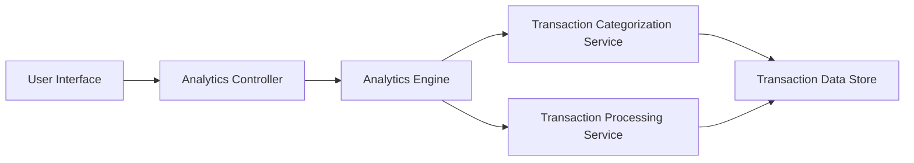

#### 1. High-Level Design

- **Summary:** This epic delivers interactive analytics and visualization capabilities that enable users to understand spending patterns through category-wise analysis and monthly trend tracking. Users can explore detailed expense breakdowns across 9 predefined categories (Food & Dining, Fuel, Shopping, Travel, Entertainment, Utilities, Healthcare, Education, Miscellaneous) and visualize monthly spending trends to identify patterns and make data-driven financial decisions.

- **Component Flow:**

- **Integration Points:**
  - **Upstream:** Transaction Categorization Service (classifies expenses into categories), Transaction Processing Service (provides historical transaction data), Analytics Engine (performs trend calculation and aggregation)
  - **Downstream:** User Interface (displays interactive charts and category breakdowns)

- **Key Assumptions:**
  - Transaction categorization is automated with machine learning or rule-based classification achieving 95% accuracy
  - Historical data is stored for at least 12 months and aggregated at daily/monthly granularity for trend analysis

- **NFR Highlights:** Analytics visualizations must render within 3 seconds, support interactive filtering without page reload, handle historical data for at least 12 months, ensure 95% transaction categorization accuracy

- **Data Flow:** User accesses the analytics dashboard and selects filters (date range, category). The Analytics Controller requests data from the Analytics Engine, which retrieves categorized transaction data from the Transaction Categorization Service and historical transaction data from the Transaction Processing Service. Both services query the Transaction Data Store. The Analytics Engine aggregates spending by category and calculates monthly trends, returning processed data to the Analytics Controller. The UI renders interactive visualizations including category-wise spending breakdowns and monthly trend charts with drill-down capabilities.

#### 2. Validation Report

- **Requirements Coverage:** The design comprehensively covers all scope elements including category-wise spending visualization, monthly spend trend charts, interactive analytics dashboard, spending breakdown by category, trend analysis over time, and category filtering with drill-down capabilities. All NFRs are addressed: 3-second render time through optimized data aggregation, interactive filtering via client-side state management, 12-month historical data retention, and 95% categorization accuracy through the Transaction Categorization Service. Integration dependencies are clearly mapped to the three required services.