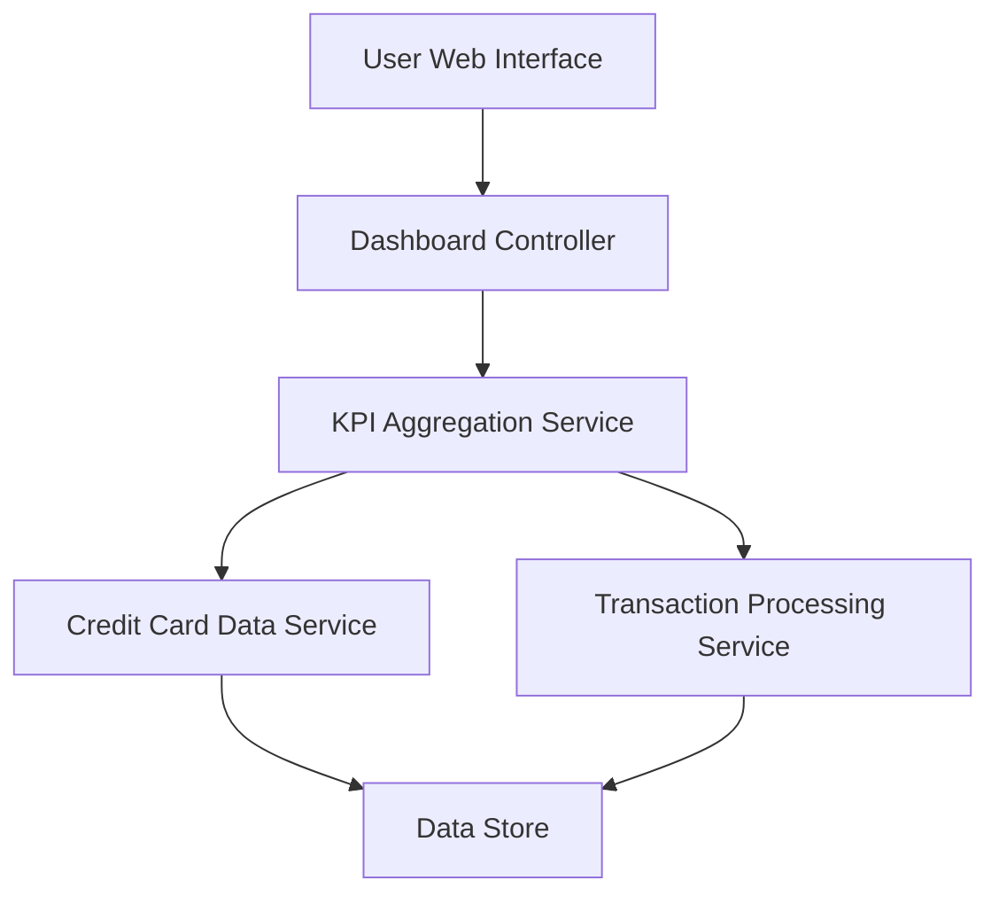

#### 1. High-Level Design

- **Summary:** This epic implements a consolidated dashboard that displays key performance indicators (KPIs) for a user's entire credit card portfolio. It aggregates and visualizes critical financial metrics including monthly spend, total credit limit, available credit, and outstanding amounts across all cards, providing real-time visibility into financial health and credit utilization.

- **Component Flow:**

- **Integration Points:**
  - **Upstream:** Credit Card Data Service (retrieves card balances and credit limits), Transaction Processing Service (calculates monthly spend and outstanding amounts)
  - **Downstream:** User Web Interface (displays dashboard and KPIs)

- **Key Assumptions:**
  - KPI data is refreshed in near real-time (assumed refresh interval of 5-10 seconds or on-demand)
  - Dashboard supports standard web browsers (Chrome, Firefox, Safari, Edge) with responsive breakpoints at 768px (mobile) and 1024px (desktop)

- **NFR Highlights:** Dashboard must load within 2 seconds, support responsive design for mobile and desktop, handle real-time data refresh, ensure data accuracy across all metrics

- **Data Flow:** User accesses the dashboard through the web interface. The Dashboard Controller requests aggregated KPI data from the KPI Aggregation Service, which queries the Credit Card Data Service for card balances and limits, and the Transaction Processing Service for spending and outstanding amounts. Both services retrieve data from the Data Store. Aggregated KPIs (monthly spend, total credit limit, available credit, outstanding amounts) are returned to the Dashboard Controller and rendered in the UI with visualization components.

#### 2. Validation Report

- **Requirements Coverage:** The design fully covers the epic's stated scope including monthly spend display, total credit limit aggregation, available credit calculation, outstanding amount tracking, responsive dashboard layout, and KPI visualization components. All NFRs (2-second load time, responsive design, real-time refresh, data accuracy) are addressed through the component architecture. Integration dependencies with Credit Card Data Service and Transaction Processing Service are explicitly mapped in the component flow.