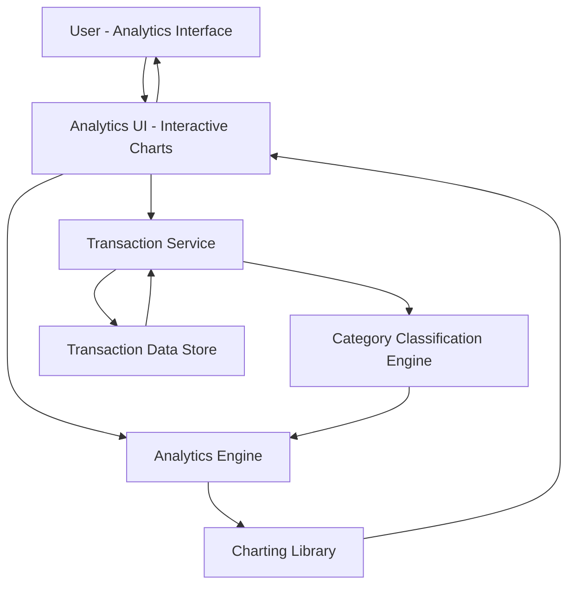

#### 1. High-Level Design

- **Summary:** This epic provides comprehensive spending analytics through interactive visualizations that help users understand their spending behavior. Users can analyze monthly spend trends over time and explore category-wise spending patterns across nine predefined categories (Food & Dining, Fuel, Shopping, Travel, Entertainment, Utilities, Healthcare, Education, and Miscellaneous). The analytics engine delivers actionable insights enabling users to identify spending patterns, control expenses, and make data-driven financial decisions with support for up to 12 months of historical data and 10,000 transactions per user.

- **Component Flow:**

- **Integration Points:**
  - **Upstream:** Transaction Service (for retrieving raw transaction data including amounts, dates, merchants, and metadata)
  - **Internal:** Category Classification Engine (for transaction categorization into nine predefined categories)
  - **Internal:** Analytics Engine (for trend calculation, pattern identification, and aggregation of spending data)
  - **Internal:** Charting Library (for rendering interactive visualizations and graphs)
  - **Downstream:** Transaction Data Store (for persistent storage of transaction records and category mappings)

- **Key Assumptions:**
  - Category classification is rule-based using merchant codes (MCC) or merchant names; machine learning-based classification is future enhancement.
  - Historical trend analysis defaults to 12 months; users can filter to shorter time periods (e.g., 3 months, 6 months) via interactive controls.

- **NFR Highlights:** Analytics visualizations must render within 3 seconds, support interactive filtering and drill-down capabilities, handle transaction data for up to 12 months of history, maintain visualization performance with up to 10,000 transactions per user.

- **Data Flow:** User accesses analytics dashboard → Analytics UI requests transaction data → Transaction Service retrieves raw transaction records from Transaction Data Store → Category Classification Engine categorizes each transaction into one of nine predefined categories → Analytics Engine aggregates data to compute monthly spend trends and category-wise spending totals → Charting Library renders interactive visualizations (line charts for trends, pie/bar charts for category breakdown) → User interacts with charts (filtering, drill-down) → Analytics Engine recalculates and updates visualizations in real-time → User gains actionable insights into spending patterns and trends.

#### 2. Validation Report

- **Requirements Coverage:** The design fully covers the epic's stated scope including monthly spend trends visualization, category-wise spending analysis across nine categories, interactive charts and graphs, spending pattern identification, nine-category classification, historical trend analysis, and responsive analytics interface. All NFRs are addressed: 3-second rendering through optimized data aggregation and caching, interactive filtering and drill-down via dedicated Analytics Engine, support for 12 months of history and 10,000 transactions through scalable data architecture and efficient querying. The design explicitly excludes out-of-scope items (real bank integration, predictive analytics, budget creation, spending alerts, third-party financial tool integrations, export functionality) as specified in the epic.