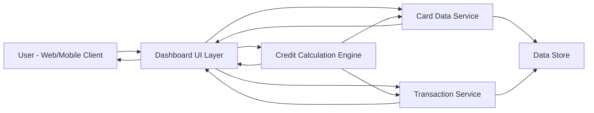

#### 1. High-Level Design

- **Summary:** This epic delivers a consolidated financial overview dashboard displaying key performance indicators for credit card management. Users can view critical metrics including monthly spend, total credit limit, available credit, and outstanding amounts across all their credit cards in a single, unified interface. The dashboard provides real-time visibility into financial health and credit utilization, enabling informed spending decisions and proactive credit management.

- **Component Flow:**

- **Integration Points:**
  - **Upstream:** Card Data Service (for retrieving card details, balances, and credit limits)
  - **Upstream:** Transaction Service (for calculating monthly spend from transaction history)
  - **Internal:** Credit Calculation Engine (for computing available credit based on limits and outstanding balances)
  - **Downstream:** Data Store (for persistent storage of card, transaction, and calculated financial data)

- **Key Assumptions:**
  - Monthly spend is calculated based on transaction data aggregated for the current calendar month; timezone is user-configurable or defaults to system timezone.
  - Available credit is computed as (Total Credit Limit - Outstanding Amount); no pending authorization holds are considered in the initial implementation.

- **NFR Highlights:** Dashboard must load within 2 seconds, support responsive design across desktop and mobile devices, handle real-time data refresh for up to 1000 concurrent users, ensure data accuracy for financial calculations.

- **Data Flow:** User accesses dashboard → Dashboard UI Layer requests KPI data → Card Data Service retrieves card details and balances → Transaction Service aggregates monthly spend from transaction records → Credit Calculation Engine computes available credit using card limits and outstanding amounts → All KPI data (monthly spend, total credit limit, available credit, outstanding amount) is consolidated and returned to UI → Dashboard renders responsive, real-time financial overview with aggregated metrics across all user credit cards.

#### 2. Validation Report

- **Requirements Coverage:** The design comprehensively covers the epic's stated scope including monthly spend display, total credit limit aggregation, available credit calculation, outstanding amount tracking, consolidated multi-card view, and responsive dashboard layout. All NFRs are addressed: 2-second load time through optimized data retrieval and caching strategies, responsive design via adaptive UI layer, support for 1000 concurrent users through scalable service architecture, and data accuracy ensured by dedicated Credit Calculation Engine. The design explicitly excludes out-of-scope items (real bank integration, card payments, fund transfers, loans, payment gateway integration) as specified in the epic.