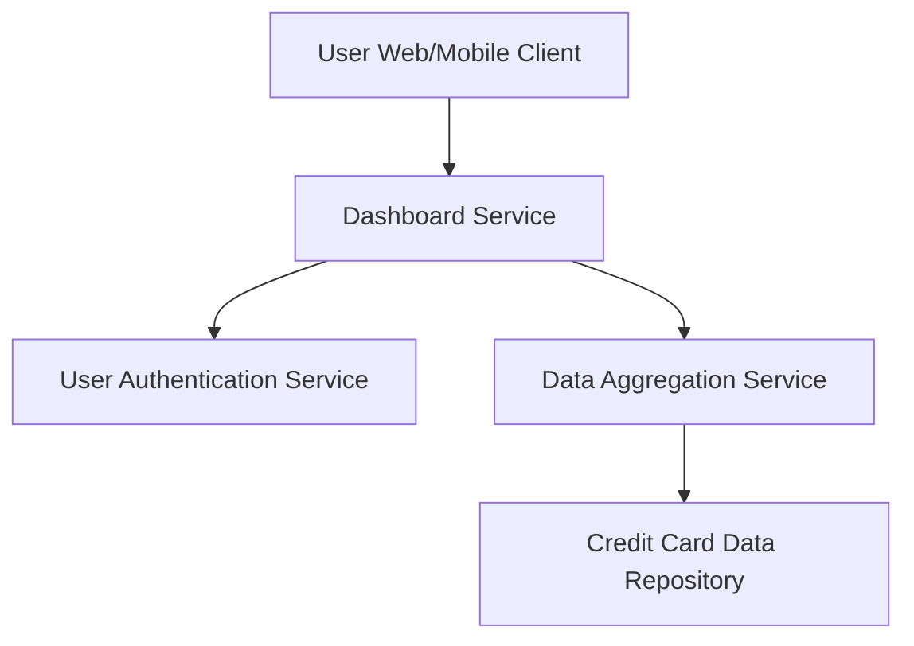

#### 1. High-Level Design

- **Summary:** This epic delivers a consolidated dashboard interface displaying critical financial KPIs including monthly spending, total credit limit across all cards, available credit, and outstanding amounts in real-time. The dashboard provides a comprehensive financial snapshot for informed decision-making, with responsive design supporting mobile, tablet, and desktop viewports.

- **Component Flow:**

- **Integration Points:**
  - **Upstream:** User Authentication Service (for user identity verification and session management)
  - **Downstream:** Credit Card Data Repository (for card data), Data Aggregation Service (for calculating consolidated metrics across multiple cards)

- **Key Assumptions:**
  - "Real-time" data refresh means near real-time (e.g., within seconds to minutes); actual refresh frequency not specified (assumed periodic polling or event-driven updates).
  - Multi-card calculations (total limit, available credit, outstanding) are performed by Data Aggregation Service; card data is assumed to be consistent and synchronized.

- **NFR Highlights:** Dashboard must load within 2 seconds, support real-time data refresh, responsive design for mobile/tablet/desktop, and maintain 99.9% data accuracy.

- **Data Flow:** User accesses dashboard → Dashboard Service authenticates user via User Authentication Service → Data Aggregation Service retrieves card data from Credit Card Data Repository → Aggregation Service calculates KPIs (monthly spend, total credit limit, available credit, outstanding amount) across all user cards → Dashboard Service returns consolidated metrics to client → Responsive UI renders KPIs optimized for user's device viewport.

#### 2. Validation Report

- **Requirements Coverage:** The design fully addresses the epic's scope including monthly spend KPI display, total credit limit calculation/display, available credit calculation/display, outstanding amount tracking, consolidated multi-card view, and responsive dashboard layout. All NFRs (2s load time, real-time refresh, responsive design for multiple viewports, 99.9% data accuracy) are covered through efficient dashboard service, dedicated data aggregation layer, and responsive UI architecture.