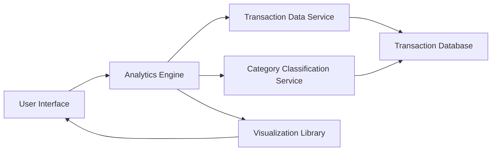

#### 1. High-Level Design

- **Summary:** This epic provides comprehensive spending analytics through interactive visualizations, enabling users to analyze spending patterns across 9 predefined categories (Food & Dining, Fuel, Shopping, Travel, Entertainment, Utilities, Healthcare, Education, Miscellaneous). Users can view monthly trends, transaction-level details, and identify spending habits for data-driven financial decisions.

- **Component Flow:**

- **Integration Points:**
  - **Upstream:** Transaction Data Service (for raw transaction data), Category Classification Service (for categorizing transactions into predefined categories)
  - **Downstream:** Transaction Database (for storing and retrieving transaction records), Visualization Library (for rendering interactive charts and graphs)

- **Key Assumptions:**
  - Transactions are pre-classified into one of the 9 predefined categories; no custom category creation is supported.
  - Monthly aggregation is computed on-demand or cached; data refresh frequency is not specified (assumed near real-time or daily batch).

- **NFR Highlights:** Visualizations must render within 1.5 seconds, system must handle minimum 1000 transactions per user, charts must be interactive and responsive, and data aggregation must be accurate to the cent level.

- **Data Flow:** User accesses analytics dashboard → Analytics Engine queries Transaction Data Service for user transactions → Category Classification Service ensures transactions are categorized → Analytics Engine aggregates data by category and time period → Visualization Library renders interactive charts (category-wise spend, monthly trends) → User interacts with charts to drill down into transaction details.

#### 2. Validation Report

- **Requirements Coverage:** The design comprehensively covers all stated requirements including category-wise spending visualization, monthly spend trends analysis, transaction list and details, interactive charts, spending pattern identification, multi-category support for 9 categories, and time-based analysis. All NFRs (1.5s rendering, 1000+ transactions, interactive/responsive charts, cent-level accuracy) are addressed through dedicated analytics engine, visualization library, and efficient data aggregation mechanisms.