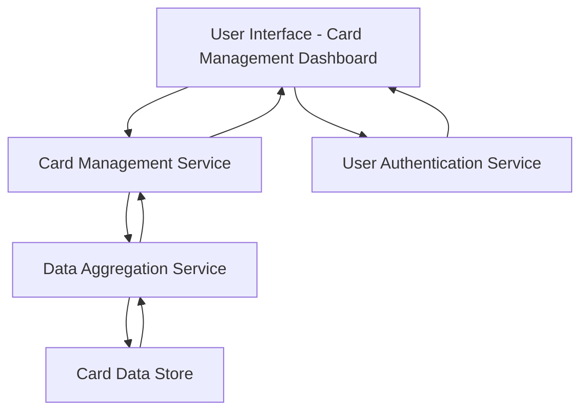

#### 1. High-Level Design

- **Summary:** This epic enables users to manage and monitor multiple credit cards from a single, centralized interface. Users can view all their credit cards with individual card details, track card-specific spending patterns, analyze performance across different cards, and compare utilization, limits, and spending across their entire credit card portfolio. The system must support a minimum of 10 cards per user with the ability to scale to 50 cards while maintaining performance.

- **Component Flow:**

- **Integration Points:**
  - **Upstream:** User Authentication Service (for secure access control and user identity verification)
  - **Internal:** Card Management Service (for card data retrieval and management operations)
  - **Internal:** Data Aggregation Service (for multi-card calculations, comparisons, and portfolio-level metrics)
  - **Downstream:** Card Data Store (for persistent storage of card information and metadata)

- **Key Assumptions:**
  - Card data is stored in a structured format with standardized fields (card number, limit, balance, issuer, etc.) accessible via RESTful APIs.
  - Card synchronization occurs on-demand or at scheduled intervals; real-time updates from external card issuers are out of scope.

- **NFR Highlights:** System must support minimum 10 cards per user, card data must sync within 5 seconds, interface must maintain performance with up to 50 cards displayed, ensure secure storage and display of card information (encryption at rest and in transit).

- **Data Flow:** User authenticates via User Authentication Service → User Interface requests card portfolio data → Card Management Service retrieves individual card records → Data Aggregation Service calculates portfolio-level metrics (total limits, total outstanding, utilization ratios) → Aggregated data and individual card details are returned to UI → User views consolidated multi-card dashboard with card-specific and portfolio-level insights.

#### 2. Validation Report

- **Requirements Coverage:** The design fully covers the epic's stated scope including multiple card display, card-wise spend analysis, individual card details view, card comparison capabilities, card-specific outstanding balances, and card-level credit limit tracking. All NFRs (10+ cards per user, 5-second sync, 50-card performance, secure storage) are addressed through the architecture's separation of concerns, dedicated data aggregation service, and authentication layer. The design explicitly excludes out-of-scope items (real bank integration, payments, fund transfers, card application/closure) as specified in the epic.