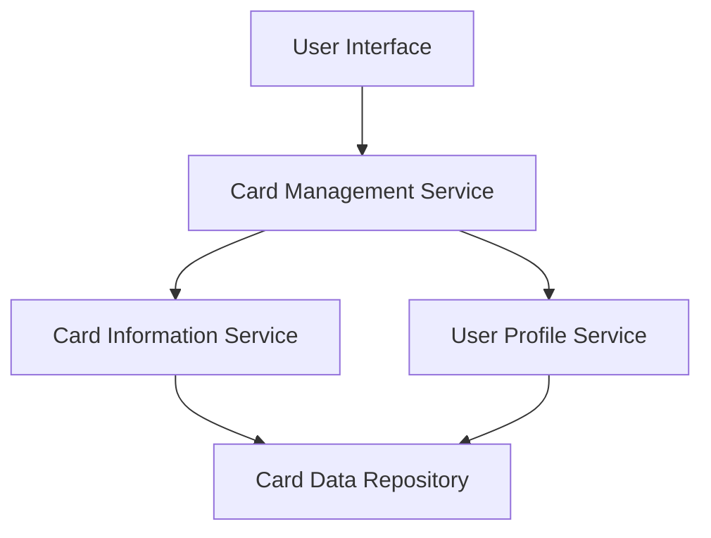

#### 1. High-Level Design

- **Summary:** This epic delivers a unified interface for users to view and manage multiple credit cards from a single dashboard. Users can view all cards with their details, switch between cards, and access card-specific information including credit limits, balances, and usage patterns. The system must support at least 10 cards per user with secure data handling and efficient UI performance.

- **Component Flow:**

- **Integration Points:**
  - **Upstream:** User Profile Service (for user authentication and profile data)
  - **Downstream:** Card Data Repository (for retrieving card details), Card Information Service (for card-specific metadata and attributes)

- **Key Assumptions:**
  - Card data is pre-populated in the repository and synchronized periodically (not real-time bank integration).
  - Card identification uses a unique card ID or token; actual card numbers are masked for security.

- **NFR Highlights:** System must support minimum 10 credit cards per user with secure transmission (encryption in transit/at rest), and UI performance must not degrade with increased card count.

- **Data Flow:** User requests card list via UI → Card Management Service authenticates user via User Profile Service → Card Information Service retrieves card details from Card Data Repository → Aggregated card data (limits, balances, usage) returned to UI → User selects a card → Card-specific details displayed with individual metrics.

#### 2. Validation Report

- **Requirements Coverage:** The design fully covers the epic's scope including multi-card display, card-specific details view, card selection/navigation, individual credit limit display, card-wise spend analysis, and card identification. All NFRs (10+ cards support, secure storage/transmission, efficient UI handling, performance scalability) are addressed through the architecture with dedicated services for card management, profile, and data retrieval.