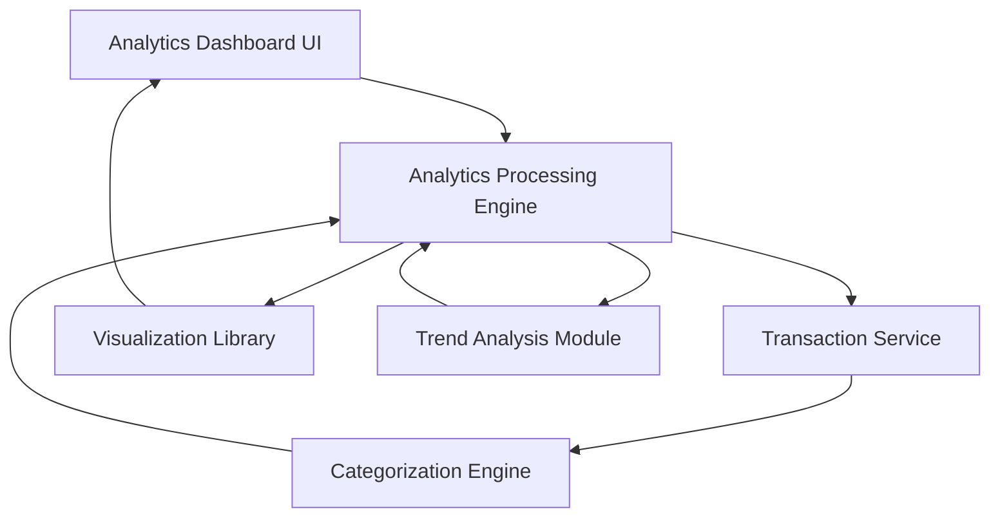

#### 1. High-Level Design

- **Summary**: This epic provides comprehensive spending analytics and visualization capabilities to help users understand spending patterns. Users access interactive visualizations showing category-wise spending breakdown across 9 predefined categories (Food & Dining, Fuel, Shopping, Travel, Entertainment, Utilities, Healthcare, Education, Miscellaneous) and monthly spend trend analysis for data-driven financial decisions.

- **Component Flow**:

- **Integration Points**: 
  - **Upstream**: Transaction Service (for retrieving raw transaction data)
  - **Internal**: Analytics Engine (for processing spending patterns and aggregations)
  - **Internal**: Categorization Engine (for assigning transactions to predefined categories)
  - **Frontend**: Visualization Library (for rendering interactive charts with drill-down capabilities)

- **Key Assumptions**: 
  - Transactions are auto-categorized using merchant codes or ML-based classification with 95%+ accuracy.
  - Historical transaction data is retained for at least 12 months to support trend analysis.

- **NFR Highlights**: Analytics visualizations must render within 1 second; system must process and categorize transactions with 95% or higher accuracy; charts must be interactive and support drill-down capabilities.

- **Data Flow**: User accesses analytics dashboard → Analytics Processing Engine retrieves transactions from Transaction Service → Categorization Engine assigns each transaction to one of 9 predefined categories → Engine aggregates spending by category and time period → Trend Analysis Module calculates monthly patterns and trends → Visualization Library renders interactive charts (category breakdown, monthly trends) → User interacts with visualizations (drill-down, filter by date/category) → Engine re-processes filtered data → UI updates charts in real-time.

#### 2. Validation Report

- **Requirements Coverage**: The design fully satisfies the epic scope including category-wise spending visualization across all 9 predefined categories, monthly spend trend charts, interactive analytics dashboard, spending pattern analysis, and transaction categorization/aggregation. The architecture ensures sub-1-second visualization rendering through optimized data processing pipelines, meets the 95% categorization accuracy requirement through dedicated categorization engine, and supports interactive drill-down capabilities via the visualization library. All NFRs are addressed with appropriate technical components.