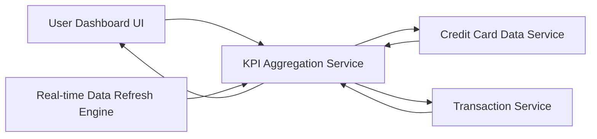

#### 1. High-Level Design

- **Summary**: This epic delivers a consolidated dashboard displaying key performance indicators for the credit card portfolio. The dashboard provides real-time visibility into monthly spending, total credit limit, available credit, and outstanding amounts across all cards. Users can monitor financial health through a responsive interface presenting critical metrics for informed decision-making.

- **Component Flow**:

- **Integration Points**: 
  - **Upstream**: Credit Card Data Service (for fetching card details, balances, and credit limits)
  - **Upstream**: Transaction Service (for calculating monthly spend metrics and outstanding amounts)
  - **Internal**: Real-time Data Refresh Engine (for periodic KPI updates)

- **Key Assumptions**: 
  - Transaction data is pre-categorized and timestamped for efficient monthly aggregation.
  - Credit limit and available credit calculations are performed server-side to ensure data consistency.

- **NFR Highlights**: Dashboard must support responsive design across desktop, tablet, and mobile devices; page load time must be under 2 seconds; system must handle real-time data refresh for KPI metrics.

- **Data Flow**: User accesses dashboard → KPI Aggregation Service queries Credit Card Data Service for all card limits and balances → Service queries Transaction Service for monthly spend totals → Service calculates aggregated KPIs (total credit limit, available credit, outstanding amount, monthly spend) → Real-time refresh engine periodically updates metrics → Dashboard UI renders KPIs in responsive layout → User views consolidated financial position across all cards.

#### 2. Validation Report

- **Requirements Coverage**: The design comprehensively addresses all epic requirements including dashboard interface, monthly spend KPI display, total credit limit aggregation, available credit calculation, outstanding amount tracking, and responsive layout. The architecture incorporates real-time data refresh capabilities and supports sub-2-second page load times through optimized service aggregation and caching strategies. All NFRs for responsive design and performance are addressed.