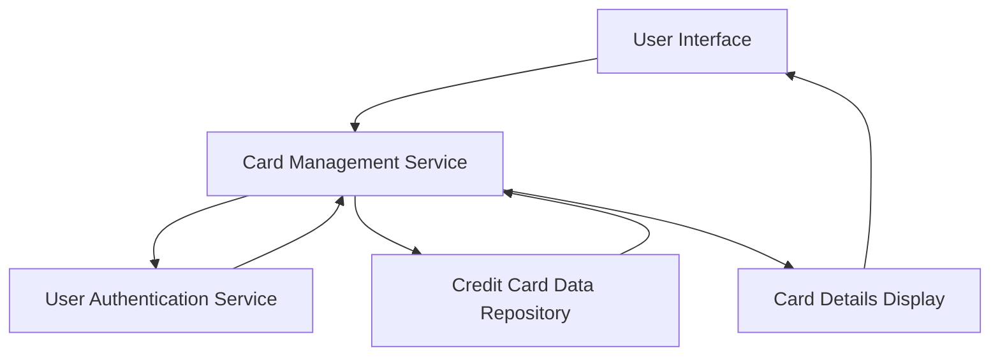

#### 1. High-Level Design

- **Summary**: This epic enables users to manage and monitor multiple credit cards within a unified interface. Users can view all their credit cards with individual details, track card-specific spending, balances, and credit limits. The system consolidates card portfolio management, allowing seamless navigation between cards without switching interfaces.

- **Component Flow**:

- **Integration Points**: 
  - **Upstream**: User Authentication Service (for user identity and card association)
  - **Downstream**: Credit Card Data Repository (for retrieving multiple card information, balances, limits, and spending data)

- **Key Assumptions**: 
  - Card data is stored in a centralized repository with standardized schema for all card types.
  - User-to-card association is maintained by the authentication service with appropriate access controls.

- **NFR Highlights**: System must support at least 10 credit cards per user; card switching must respond within 500ms; interface must maintain performance with multiple cards loaded simultaneously.

- **Data Flow**: User authenticates → Authentication service validates user identity → Card Management Service retrieves all associated cards from Credit Card Data Repository → Service aggregates card details (balances, limits, spending) → UI renders card list with individual card details → User selects specific card → Service fetches detailed card-specific data → UI displays selected card information with real-time metrics.

#### 2. Validation Report

- **Requirements Coverage**: The design fully covers the epic's stated scope including multiple credit card display interface, individual card detail views, card-wise spend analysis, card selection and navigation, and card-specific credit limit and balance display. The architecture supports all NFRs with dedicated services for authentication, data retrieval, and presentation layer optimization for sub-500ms response times.