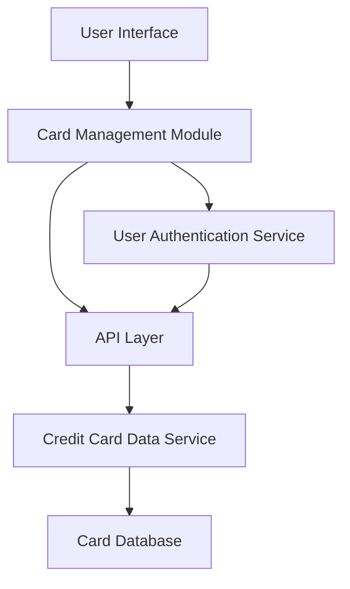

#### 1. High-Level Design

- **Summary:** This epic enables users to manage and monitor multiple credit cards (up to 10 per user) within a single platform, providing individual card details, card-wise spend analysis, credit limit tracking, outstanding balances, and card comparison capabilities in a centralized interface.

- **Component Flow:**

- **Integration Points:**
  - **Upstream:** Credit Card Data Service (for retrieving card information and balances)
  - **Upstream:** User Authentication Service (for secure card data access and authorization)
  - **Downstream:** User Interface/Client Application

- **Key Assumptions:**
  - Card data is retrieved on-demand per user session with caching to optimize performance; assumed session-based caching with TTL of 5 minutes.
  - User authentication tokens are validated before each card data retrieval request.

- **NFR Highlights:** Support for at least 10 credit cards per user; card data retrieval ≤ 3 seconds; maintain performance with multiple cards loaded.

#### 2. Validation Report

- **Requirements Coverage:** The design addresses all functional requirements including multi-card display, individual card detail views, card-wise spend analysis, credit limit tracking per card, outstanding balance per card, and card comparison capabilities. Integration dependencies with Credit Card Data Service and User Authentication Service are covered. NFRs for supporting 10 cards per user and 3-second retrieval time are incorporated into the design.