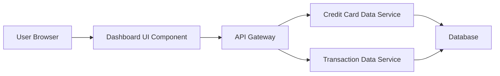

#### 1. High-Level Design

- **Summary:** This epic delivers a consolidated dashboard displaying key credit card performance indicators (Monthly Spend, Total Credit Limit, Available Credit, Outstanding Amount) across all user credit cards in a unified, responsive interface. Users gain instant visibility into their credit card portfolio health and financial standing.

- **Component Flow:**

- **Integration Points:**
  - **Upstream:** Credit Card Data Service (for card details and balances)
  - **Upstream:** Transaction Data Service (for monthly spend metrics calculation)
  - **Downstream:** User Browser/Client Application

- **Key Assumptions:**
  - KPI calculations are performed server-side and cached for performance; data refresh interval is configurable (assumed near real-time = refresh every 30-60 seconds).
  - Credit card data is pre-aggregated and available via REST APIs from backend services.

- **NFR Highlights:** Dashboard load time ≤ 2 seconds; responsive design across desktop/tablet/mobile; real-time or near real-time KPI refresh.

#### 2. Validation Report

- **Requirements Coverage:** The design covers all stated requirements including KPI display (Monthly Spend, Total Credit Limit, Available Credit, Outstanding Amount), multi-card consolidated view, and responsive layout. Integration with required backend services (Credit Card Data Service, Transaction Data Service) is addressed. NFRs for load time (2 seconds) and responsive design are incorporated into the architecture.