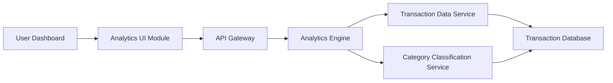

#### 1. High-Level Design

- **Summary:** This epic delivers interactive analytics and visualization capabilities enabling users to understand spending behavior through category-wise breakdowns (9 predefined categories: Food & Dining, Fuel, Shopping, Travel, Entertainment, Utilities, Healthcare, Education, Miscellaneous) and monthly trend analysis over 12 months of historical data.

- **Component Flow:**

- **Integration Points:**
  - **Upstream:** Transaction Data Service (for retrieving categorized transaction history)
  - **Upstream:** Analytics Engine (for processing and aggregating spending data)
  - **Upstream:** Category Classification Service (for transaction categorization)
  - **Downstream:** Analytics UI Module/Visualization Components

- **Key Assumptions:**
  - Transaction categorization is pre-processed and stored; assumed batch categorization runs nightly for historical data.
  - Analytics aggregations are pre-computed for common time ranges (monthly, quarterly) to meet 2-second rendering requirement.

- **NFR Highlights:** Analytics visualizations render within 2 seconds; support 12 months of historical transaction data; interactive and responsive charts across all device types.

#### 2. Validation Report

- **Requirements Coverage:** The design comprehensively covers all stated requirements including category-wise spending visualization across 9 predefined categories, monthly spend trend charts, interactive analytics dashboards, and historical spending comparison. Integration with Transaction Data Service, Analytics Engine, and Category Classification Service is addressed. NFRs for 2-second rendering, 12-month historical data support, and responsive interactive charts are incorporated into the architecture.