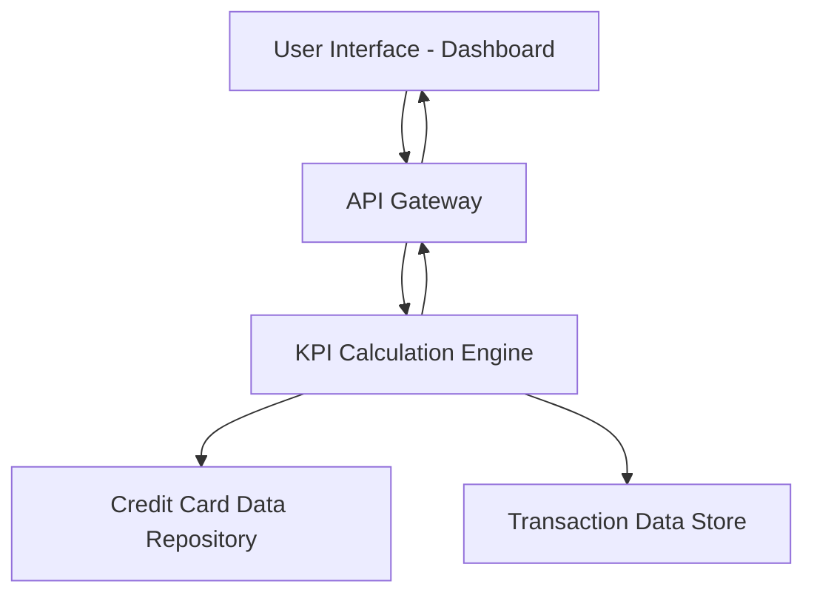

#### 1. High-Level Design

- **Summary**: This epic delivers a centralized dashboard that aggregates and displays key financial metrics across all user credit cards, including monthly spend, total credit limit, available credit, and outstanding amounts. The dashboard serves as the primary entry point for users to assess their overall credit card portfolio health.

- **Component Flow**:

- **Integration Points**: 
  - **Upstream**: Credit card data repository (provides card information, limits, outstanding balances)
  - **Upstream**: Transaction data store (provides transaction history for monthly spend calculation)
  - **Internal**: Calculation engine for aggregating financial metrics across multiple cards

- **Key Assumptions**: 
  - Financial metrics are calculated in real-time or near-real-time upon dashboard load
  - Credit card data repository provides standardized data format for all cards in the user's portfolio

- **NFR Highlights**: Dashboard must be responsive across desktop, tablet, and mobile devices; page load time must be optimized for quick KPI rendering; system must accurately calculate and display real-time financial metrics

- **Data Flow**: User requests dashboard → API Gateway authenticates and routes request → KPI Calculation Engine retrieves card data from Credit Card Data Repository and transaction data from Transaction Data Store → Engine aggregates metrics (total credit limit, available credit, outstanding amounts, monthly spend) → Calculated KPIs returned via API Gateway → Dashboard UI renders financial metrics in responsive layout

#### 2. Validation Report

- **Requirements Coverage**: The design fully covers the epic's stated scope including dashboard KPIs display, monthly spend tracking, total credit limit aggregation, available credit calculation, outstanding amount tracking, and responsive layout design. All NFRs regarding responsiveness, performance, and accuracy are addressed through the component architecture.