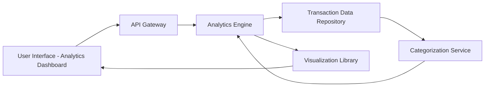

#### 1. High-Level Design

- **Summary**: This epic provides comprehensive spending analytics through interactive visualizations, enabling users to analyze transactions across nine predefined categories (Food and Dining, Fuel, Shopping, Travel, Entertainment, Utilities, Healthcare, Education, Miscellaneous). It includes monthly spend trends and category-wise breakdowns to help users understand spending patterns and identify optimization opportunities.

- **Component Flow**:

- **Integration Points**: 
  - **Upstream**: Transaction data repository (provides historical spending information and transaction details)
  - **Internal**: Analytics engine for processing and aggregating transaction data
  - **Internal**: Categorization service for classifying transactions into nine predefined categories
  - **Frontend**: Visualization library for rendering interactive charts and graphs

- **Key Assumptions**: 
  - Transactions are automatically categorized using merchant codes or transaction descriptions
  - Monthly spend trends are calculated based on transaction date and aggregated by calendar month

- **NFR Highlights**: Analytics visualizations must be interactive and responsive; system must process and categorize transactions accurately; charts and graphs must render efficiently even with large transaction datasets

- **Data Flow**: User accesses analytics dashboard → API Gateway routes request to Analytics Engine → Engine retrieves transaction history from Transaction Data Repository → Categorization Service classifies transactions into nine predefined categories → Analytics Engine aggregates spending by category and time period → Processed data formatted for visualization → Visualization Library renders interactive charts (category-wise breakdowns, monthly trends) → UI displays spending analytics with interactive exploration capabilities

#### 2. Validation Report

- **Requirements Coverage**: The design fully addresses the epic's scope including category-wise spending visualization across nine categories, monthly spend trends analysis, transaction tracking, interactive analytics charts, and spending pattern identification. The architecture supports the NFRs for interactive and responsive visualizations, accurate transaction categorization, and efficient rendering of large datasets through appropriate component separation and data processing layers.