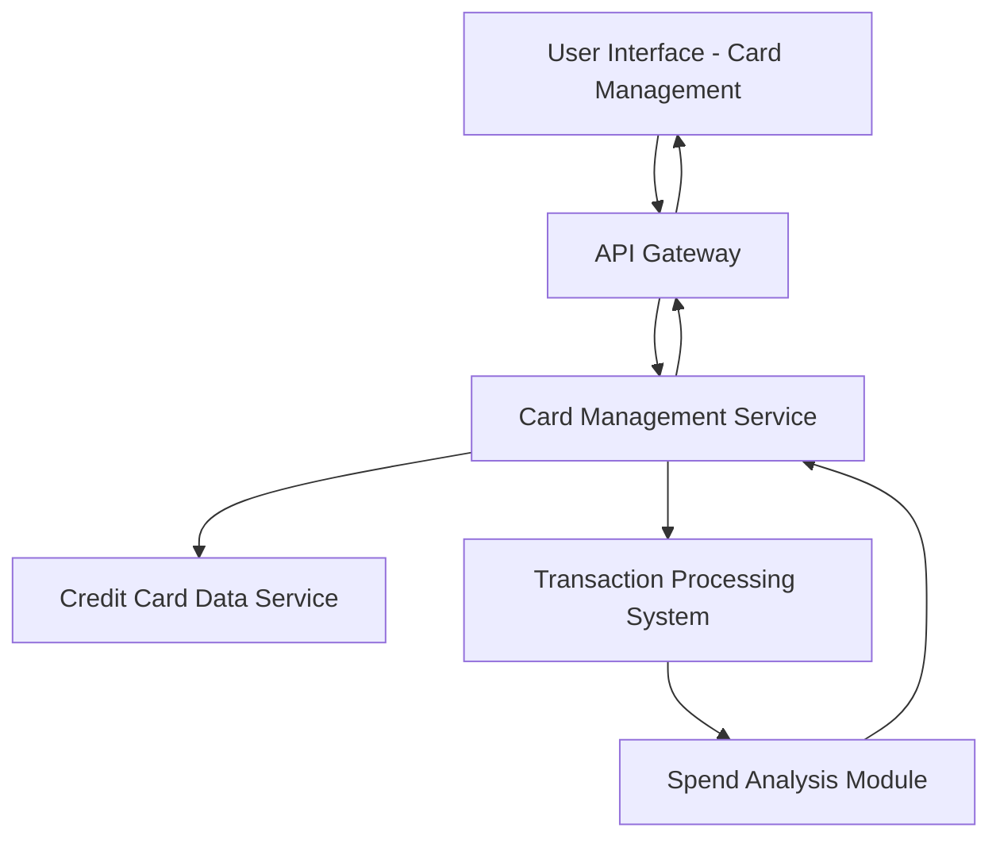

#### 1. High-Level Design

- **Summary**: This epic enables users to view, manage, and monitor multiple credit cards within a unified interface. It provides card-specific details, individual card performance analysis, card-wise spend tracking, and comparison capabilities across the user's credit card portfolio.

- **Component Flow**:

- **Integration Points**: 
  - **Upstream**: Credit card data service (retrieves individual card information, limits, status)
  - **Upstream**: Transaction processing system (provides card-specific spending data and transaction history)
  - **Internal**: Spend analysis module for card-wise spending calculations and comparisons

- **Key Assumptions**: 
  - Each credit card has a unique identifier for data segregation and retrieval
  - Card comparison logic uses standardized metrics across all cards regardless of issuer

- **NFR Highlights**: System must support viewing and managing multiple credit cards simultaneously; interface must maintain performance with increasing number of cards; data must be accurately segregated by card for analysis

- **Data Flow**: User accesses card management interface → API Gateway routes request to Card Management Service → Service retrieves individual card details from Credit Card Data Service → Transaction Processing System provides card-specific transaction data → Spend Analysis Module processes and segregates spending by card → Aggregated card portfolio data with individual card details returned → UI displays all cards with card-wise spend analysis and comparison capabilities

#### 2. Validation Report

- **Requirements Coverage**: The design comprehensively covers all scope items including multiple credit card display, card-wise spend analysis, individual card details view, card comparison capabilities, and card portfolio overview. The architecture ensures data segregation by card and supports scalable multi-card management as specified in the NFRs.