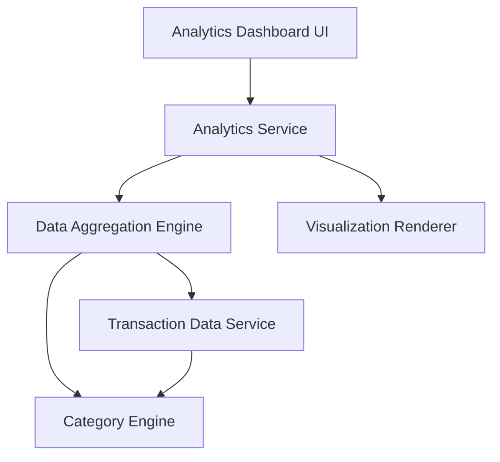

#### 1. High-Level Design

- **Summary:** This epic delivers interactive data visualizations and analytics to help users understand spending patterns through monthly trend analysis, card-wise breakdowns, and category-wise spending across nine predefined categories (Food & Dining, Fuel, Shopping, Travel, Entertainment, Utilities, Healthcare, Education, Miscellaneous).

- **Component Flow:**

- **Integration Points:** 
  - Transaction data aggregation service for processing spending data
  - Analytics engine for categorizing spending data
  - Potential integration with transaction management system for real-time data

- **Key Assumptions:** 
  - Transactions are pre-categorized into one of the nine predefined categories by the Category Engine
  - Monthly spend trends are calculated based on transaction timestamps aggregated by month

- **NFR Highlights:** Visualizations must render within 2 seconds; Charts must be interactive and responsive across all devices; System must support real-time data updates for current month analytics

- **Data Flow:** User accesses analytics dashboard → Analytics Service requests transaction data from Transaction Data Service → Data Aggregation Engine processes transactions through Category Engine to categorize into nine categories → Aggregated data is computed for monthly trends, card-wise breakdowns, and category-wise spending → Visualization Renderer generates interactive charts and graphs → Analytics Dashboard UI displays visual insights with real-time updates for current month, enabling users to identify spending patterns and make data-driven financial decisions.

#### 2. Validation Report

- **Requirements Coverage:** The design fully addresses all scope requirements including monthly spend trend visualization, card-wise spend analysis, category-wise spending breakdown across nine categories, interactive charts and graphs, spending pattern identification, and comparative spending analytics. The architecture supports all NFRs with sub-2-second visualization rendering, interactive and responsive charts across devices, and real-time data updates for current month. The design explicitly excludes out-of-scope features (predictive analytics, budget creation, spending recommendations, AI-based categorization, and export capabilities) while delivering comprehensive spending insights through the defined analytics capabilities.