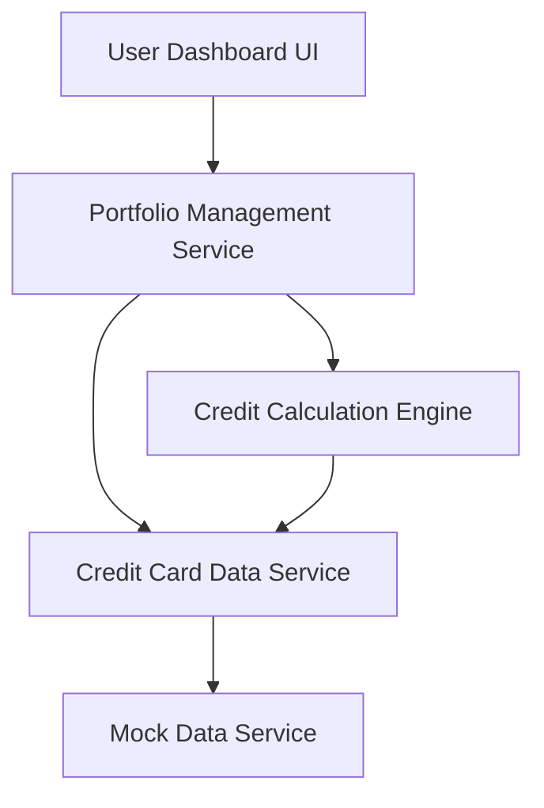

#### 1. High-Level Design

- **Summary:** This epic provides a consolidated dashboard interface for users to view and manage multiple credit cards with key financial metrics (monthly spend, total credit limit, available credit, outstanding amounts), enabling efficient portfolio tracking and informed financial decision-making.

- **Component Flow:**

- **Integration Points:** 
  - Credit card data source or mock data service for card information retrieval
  - Potential integration points for real-time credit limit and balance updates

- **Key Assumptions:** 
  - Credit card data is provided via mock data service initially (real bank integration is out of scope)
  - Available credit is calculated as (Total Credit Limit - Outstanding Amount)

- **NFR Highlights:** System must provide responsive layouts across desktop, tablet, and mobile devices; Dashboard must load within 3 seconds; Support concurrent viewing of multiple credit cards without performance degradation

- **Data Flow:** User accesses dashboard → Portfolio Management Service requests card data from Credit Card Data Service → Mock Data Service provides card information → Credit Calculation Engine computes available credit and aggregates metrics → Dashboard UI displays KPIs (monthly spend, total credit limit, available credit, outstanding amounts) for all cards → User views consolidated portfolio with responsive layout across devices.

#### 2. Validation Report

- **Requirements Coverage:** The design comprehensively covers all scope items including dashboard KPIs display, multiple credit card view, monthly spend tracking, total credit limit display, available credit calculation, outstanding amount tracking, and responsive layout design. The architecture supports all NFRs with responsive design patterns, 3-second load time optimization, and concurrent multi-card viewing. The mock data service integration satisfies the dependency requirement while keeping real bank integration out of scope as specified.