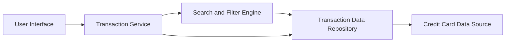

#### 1. High-Level Design

- **Summary:** This epic enables comprehensive transaction tracking across multiple credit cards, providing users with detailed transaction history, search/filter capabilities, and transaction-level details for better expense monitoring and fraud detection.

- **Component Flow:**

- **Integration Points:** 
  - Transaction data service or repository for retrieving historical and current transaction data
  - Credit card data source for multi-card transaction aggregation

- **Key Assumptions:** 
  - Transaction data is available in a standardized format from the data repository
  - Transaction categorization is pre-processed and stored in the data source

- **NFR Highlights:** Transaction list must support pagination for large datasets; Search and filter operations must complete within 1 second; System must handle transaction history for at least 12 months

- **Data Flow:** User requests transaction data through the UI → Transaction Service retrieves data from Transaction Data Repository → Search and Filter Engine processes user queries against the repository → Filtered/sorted transaction data is returned to UI → User can drill down into transaction details. The system aggregates transactions across multiple cards by querying the Credit Card Data Source.

#### 2. Validation Report

- **Requirements Coverage:** The design fully covers the epic's stated scope including transaction listing, search and filtering, transaction details view, multi-card transaction aggregation, and transaction history access. The architecture supports all NFRs with pagination for large datasets, sub-second search performance, and 12-month historical data retention. All in-scope features are addressed while explicitly excluding out-of-scope items (real bank integration, transaction editing, payment processing, receipt uploads, and disputes).