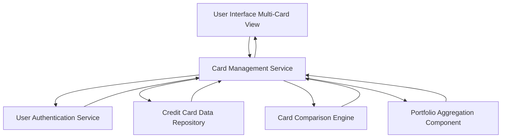

#### 1. High-Level Design

- **Summary:** This epic enables users to manage and monitor multiple credit cards from a unified interface. The core requirement is to provide individual card details, card-to-card comparison capabilities, and a comprehensive portfolio overview including card-specific limits, balances, and usage patterns with seamless navigation.

- **Component Flow:**

- **Integration Points:**
  - **Upstream:** Credit card data repository for storing and retrieving multiple card information
  - **Authentication:** User authentication service for secure card access and user-specific card portfolio retrieval
  - **Data Repository:** Centralized credit card data repository containing card details, balances, limits, and usage data for all user cards

- **Key Assumptions:**
  - Each user can have multiple cards linked to their account with unique identifiers
  - Card comparison logic assumes standardized data structure across all cards (same attributes available for comparison)

- **NFR Highlights:** System must support management of multiple credit cards per user without performance degradation; Card data must be securely stored and displayed; Interface must handle varying numbers of cards efficiently

- **Data Flow:** User authenticates and accesses Multi-Card View → Card Management Service verifies user identity via User Authentication Service → Service retrieves all cards associated with the user from Credit Card Data Repository → Portfolio Aggregation Component calculates portfolio-level metrics (total limits, total balances, overall usage) → Card Comparison Engine processes card-specific data for side-by-side comparison → Card Management Service sends individual card details, portfolio overview, and comparison data to UI → User Interface renders card list, individual card details, comparison views, and portfolio summary with seamless navigation between cards

#### 2. Validation Report

- **Requirements Coverage:** The design fully addresses the epic's scope including multiple credit card display, card-wise spend analysis, individual card details view, card comparison functionality, card portfolio overview, and card-specific balance and limit tracking. The architecture supports all NFRs through dedicated components for secure data handling, efficient multi-card management without performance degradation, and flexible interface handling for varying numbers of cards. Integration dependencies with credit card data repository and user authentication service are explicitly incorporated into the component design.