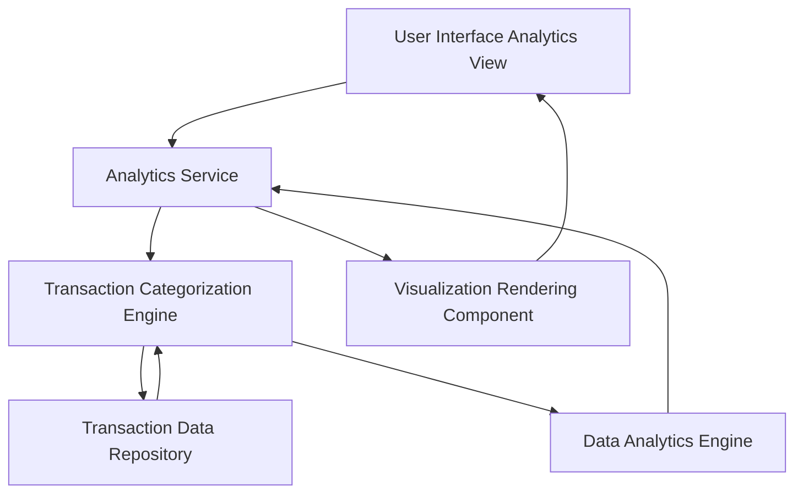

#### 1. High-Level Design

- **Summary:** This epic provides comprehensive spending analytics through interactive visualizations that enable users to understand spending patterns across multiple categories. The core requirement is to deliver category-wise spending analysis (Food & Dining, Fuel, Shopping, Travel, Entertainment, Utilities, Healthcare, Education, Miscellaneous) with monthly trend analysis and actionable insights.

- **Component Flow:**

- **Integration Points:**
  - **Upstream:** Transaction data source for retrieving raw transaction data
  - **Data Processing:** Data analytics engine for trend calculations, pattern identification, and statistical analysis
  - **Downstream:** Interactive visualization library/framework for rendering charts and graphs
  - **Data Repository:** Transaction Data Repository containing historical transaction records

- **Key Assumptions:**
  - Transactions are pre-categorized or categorization rules are defined (e.g., merchant codes map to spending categories)
  - Monthly trends are calculated based on calendar months with data available for at least 3-6 months of history

- **NFR Highlights:** Analytics visualizations must be interactive and responsive; Category calculations must be accurate and update in real-time; System must handle large transaction volumes efficiently for trend analysis

- **Data Flow:** User accesses Analytics View → Analytics Service requests transaction data → Transaction Categorization Engine retrieves transactions from Transaction Data Repository → Engine categorizes transactions into predefined categories (Food, Fuel, Shopping, etc.) → Data Analytics Engine processes categorized data to calculate monthly trends, spending patterns, and category breakdowns → Processed analytics data is sent to Visualization Rendering Component → Interactive charts and graphs are rendered in the UI showing category-wise spending, trends, and insights

#### 2. Validation Report

- **Requirements Coverage:** The design comprehensively covers the epic's scope including category-wise spending visualization, monthly spend trends analysis, transaction categorization across all specified categories, interactive spending charts, and spending pattern identification. The architecture supports all NFRs with dedicated components for interactive visualizations, real-time accuracy through the analytics engine, and efficient handling of large transaction volumes through optimized data repository access. Integration dependencies with transaction data sources and analytics engines are explicitly addressed.