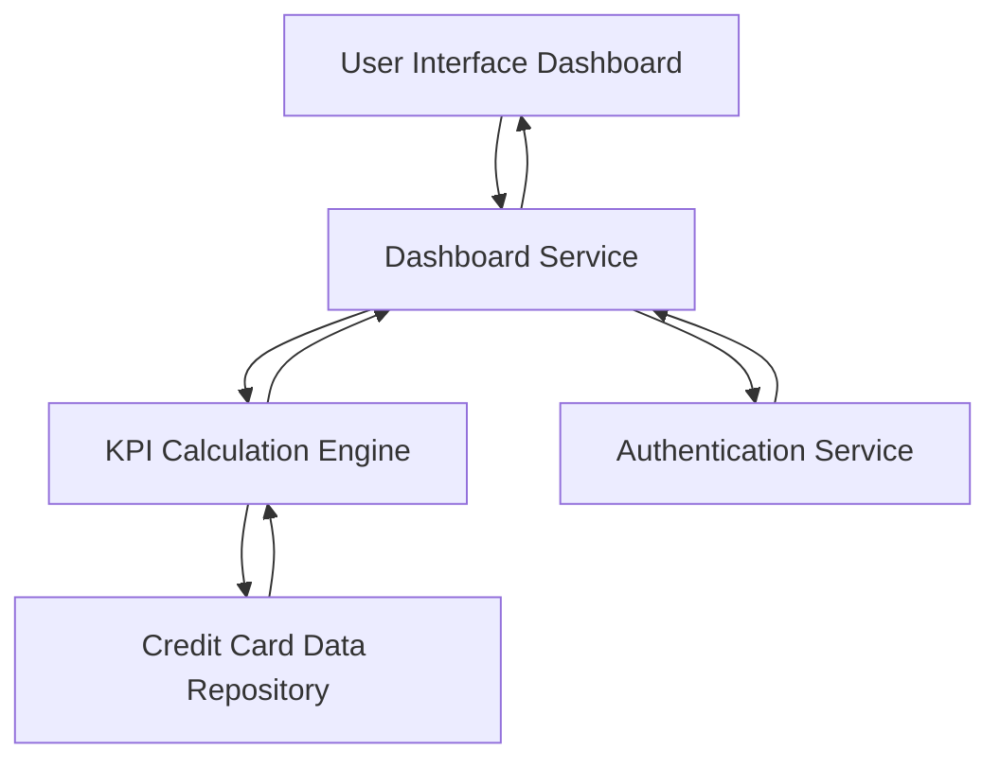

#### 1. High-Level Design

- **Summary:** This epic delivers a centralized dashboard that aggregates and displays key performance indicators (KPIs) for a user's credit card portfolio. The core requirement is to provide real-time visibility into financial metrics including monthly spend, total credit limit, available credit, and outstanding amounts across all cards in a responsive interface.

- **Component Flow:**

- **Integration Points:** 
  - **Upstream:** Credit card data source or database for retrieving card balances, limits, and transaction data
  - **Downstream:** User authentication service for secure access to dashboard
  - **Data Repository:** Credit card data repository containing card details, balances, limits, and transaction history

- **Key Assumptions:** 
  - Credit card data is refreshed in near real-time (within 1-5 minutes) from the source system
  - KPI calculations assume standard financial formulas (e.g., Available Credit = Total Limit - Outstanding Amount)

- **NFR Highlights:** Dashboard must be responsive across desktop, tablet, and mobile devices; KPI calculations must be accurate and real-time; System must support concurrent viewing by multiple users

- **Data Flow:** User authenticates and accesses the dashboard UI → Dashboard Service requests user's credit card data → KPI Calculation Engine retrieves card balances, limits, and transactions from Credit Card Data Repository → Engine calculates aggregated metrics (monthly spend, total limit, available credit, outstanding amounts) → Calculated KPIs are returned to Dashboard Service → Dashboard UI renders responsive KPI visualizations for user viewing

#### 2. Validation Report

- **Requirements Coverage:** The design fully covers the epic's stated scope including dashboard KPI display, monthly spend tracking, total credit limit aggregation, available credit calculation, outstanding amount monitoring, responsive layout, and multi-card consolidated view. The component architecture supports all NFRs including responsiveness, real-time accuracy, and concurrent user access. Integration dependencies with credit card data sources are addressed through the Credit Card Data Repository component.